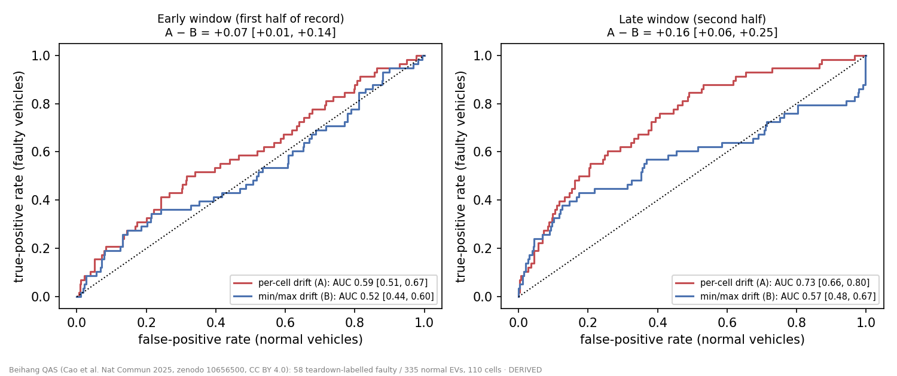
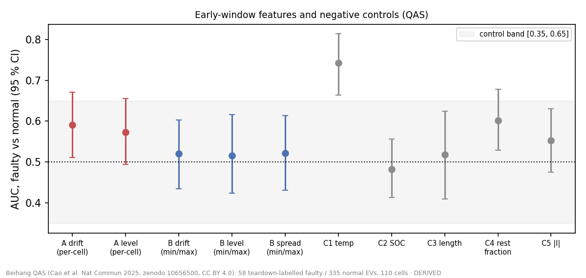

# Results G.2 — per-cell vs min/max flagging of teardown-confirmed faulty packs (Beihang QAS)

Experiment G.2, run 2026-10-15.

- **Pre-registration:** [`G2_preregistration.md`](G2_preregistration.md), commit `05af194`. It was committed before
  any analysis code existed or any feature had been compared with a label.
- **Code:** `analysis/G2_beihang.py` and `analysis/G2_plots.py`.
- **Data:** Cao et al., *Nat Commun* 2025, Zenodo 10656500, **CC BY 4.0** (commercial use allowed, unlike Changan).
  Labels SOURCED: *"determined by product engineers after disassembling the battery pack samples"*.
- Every number below is **DERIVED** from the released telemetry. No regulatory or economic claim is made.

## Verdict

**Weak early flagging exists, and per-cell data beats min/max at it.** The per-cell edge is *resolvable*, but the
signal falls short of the pre-registered 0.70 bar for "SUPPORTED".

| QAS: 58 faulty vs 335 normal EVs, 110 cells | AUC (95 % CI) |
|---|---|
| **A: per-cell drift, early window (primary)** | **0.59** (0.51–0.67) |
| **B: min/max drift, early window (comparator)** | **0.52** (0.44–0.60) |
| **A − B, early** | **+0.07** (+0.01 to +0.14) |
| A, late window | 0.73 (0.66–0.80) |
| B, late window | 0.57 (0.48–0.67) |
| **A − B, late** | **+0.16** (+0.06 to +0.25) |

**Classification note.** These numbers fall in a gap in the pre-registered decision table (deviation 1):

- AUC_A's CI lower bound is > 0.5, and the A − B CI excludes 0.
- But AUC_A = 0.59, which is below the 0.70 threshold "SUPPORTED" required.

So the honest classification is:

- **Not "SUPPORTED"**, because the flagging is too weak to act on alone.
- **Not "per-cell adds nothing"**, because the edge over min/max is resolvable.

**This is the first result in E–H where per-cell data does better than min/max**, and it comes from labels that do
not come from the telemetry. The Changan result in F found 98 % overlap between per-cell and min/max detection, but
it had no ground truth and only 3 positives.

## What supports it, and what qualifies it

1. **Per-cell and min/max point at different cells.**
   - In only **28 %** of faulty vehicles is the cell flagged by A also the cell most often at the pack minimum.
   - The cell flagged by A sits at the minimum in a median of **2.5 %** of rest frames.
   - Per-cell data is seeing *a cell drifting relative to its siblings while it is not the weakest cell*. That is
     exactly what a min/max scalar cannot see.
2. **The signal grows towards the end of the record.**
   - A rises from 0.59 to 0.73 between the early and late windows; B rises only from 0.52 to 0.57.
   - This fits records that end near the failure, but that is **ASSUMED**: the release has no failure dates.
3. **Cohort confound, flagged by the pre-registered controls.**
   - Two negative controls fall outside the [0.35, 0.65] band:
     - median **temperature**: AUC 0.74, faulty median 20 °C vs normal 17 °C;
     - **rest fraction**: AUC 0.60.
   - Since the faulty vehicles are also contiguous IDs (335–392), they were probably collected as a separate batch.
     By the pre-registered rule, the result is therefore flagged **"cohort-distinguishable"**.
4. **The confound does not seem to drive A.**
   - In the pre-registered adjusted logistic model (label ~ feature + all 5 controls), A's coefficient stays positive
     with a CI that excludes 0: **+0.30 (+0.04 to +0.51)**. B's does not: +0.12 (−0.27 to +0.40).
   - A post-hoc check, not pre-registered: A is uncorrelated with temperature among normal vehicles (Spearman 0.01).
   - Temperature-stratified AUCs (2 °C bins), also post-hoc:

| Feature | Early | Late |
|---|---|---|
| A | 0.59 | 0.66 |
| B | 0.53 | 0.48 |

## Secondary (pre-registered, report-only)

**Static-level features, early window:**

| Feature | AUC (95 % CI) |
|---|---|
| A_lvl (per-cell) | 0.57 (0.50–0.66) |
| B_lvl (min/max) | 0.52 (0.42–0.62) |
| B_spr (min/max spread) | 0.52 (0.43–0.61) |

The per-cell *drift* feature (A) carries more than the per-cell *level* feature.

**DTI** (72 eligible, 3 faulty). Percentile rank of each faulty vehicle among DTI vehicles:

| Feature | Vehicle 1 | Vehicle 2 | Vehicle 3 |
|---|---|---|---|
| A | 92 % | 18 % | 6 % |
| B | 93 % | 43 % | 40 % |

Too few positives to read anything into.

**Mileage sanity.** vin_1 column 2 is non-decreasing in 83 % of vehicles. In the rest it is not strictly monotone, so
the normalised column is a noisy mileage proxy, or something else. Row order is still taken as time order, as the
authors' own sequential models do.

## Deviations and disclosures

1. **Gap in the decision table.** The pre-registered table had no row for "AUC_A CI > 0.5 and difference CI > 0, but
   AUC_A < 0.70".
   - The first run's code dropped that case into "per-cell adds nothing resolvable", which mislabels it.
   - The code now names the case explicitly. A re-run gave identical numbers; only the verdict string changed.
   - No threshold was moved.
2. **Post-hoc analyses.** The temperature-stratified AUCs and the A–temperature correlation are post-hoc.
3. **Assumed column layout.** It is taken from the authors' `Train_.py`, which slices vin_2 as `[x(2) | y(110) |
   z(110) | q(3)]`.
   - For q, the order (temperature, SOC, current) is inferred from value ranges, and from a negative dV/dI sign
     consistent with discharge-positive current.
   - DTI uses k = 85, inferred from the width: (175 − 5) / 2.
4. **Eligibility.**
   - QAS: all 393 vehicles were eligible.
   - DTI: 8 of 80 were ineligible, because they had too few rest frames.

## What this does and does not show

**Does:**

- On 393 real EVs with teardown-confirmed outcomes, a per-cell "one cell drifting against its siblings" feature
  separates faulty from normal packs better than the same feature built from min/max scalars.
- The two monitors mostly flag *different* cells.

**Does not:**

- **The lead time is unknown.** There are no failure dates.
- **No per-fault-type or per-cell truth.** Labels are vehicle-level and binary.
- **Not deployable.** An AUC of 0.59 early (0.73 late) is far from an alarm-grade detector.
- **Cohort difference not excluded.** A difference between the faulty and normal cohorts that is unrelated to the
  fault is reduced by the controls but not excluded.

**Bottom line.** Across E–H, the answer was "min/max is enough". This changes it to a qualified **"per-cell sees
something min/max doesn't, before failure"**. The effect is modest. It is the first time a label that does not come
from the telemetry has backed per-cell over min/max.

## Post-review addendum (2026-10-15, independent review) — **verdict substantially weakened**

See [`review_2026-10-15/REVIEW.md`](../review_2026-10-15/REVIEW.md). The original text above is unchanged except where marked.

1. **The faulty and normal cohorts were processed differently** (✔ reproduced by the main session).
   - **Current sentinel:** all 335 normal vehicles have current-sentinel (−1000) frames; only 17 of 58 faulty do.
   - **Temperature:** median maximum temperature is 41 °C faulty vs 31 °C normal.
   - **Further differences found by the reviewer:**
     - faulty records have about 2× the contiguous runs (AUC 0.83);
     - they end hotter from the same start;
     - their x/z columns differ by orders of magnitude.
   - None of these were among the 5 pre-registered controls, so "A survives adjustment" adjusted for the wrong
     covariates.
2. **The pre-registered A − B edge does not survive cohort stratification.** Within temperature strata, permutation
   p = 0.11; within temperature × rest-count strata, p = 0.067.
   - Early A alone stays at AUC ≈ 0.59–0.61 under stratification and matching, with p ≈ 0.03–0.08.
3. **The late-window signal is not drift.** Shuffling the block order leaves late A at 0.71. Under temperature × SOC
   stratification, late A falls to 0.60, and late B becomes anti-predictive inside strata.
4. **Early A − B is fragile** (post-hoc sensitivity). It loses significance with block mean instead of median (A − B
   = −0.007), and with most alternative rest thresholds or windows.
5. **Layout corrections.**
   - The z columns are model-derived, not per-cell temperatures.
   - vin_1 column 2 is identically zero for QAS, so the "mileage sanity" check was vacuous.
   - The G.2 rest-fraction AUC of 0.60 is *inside* [0.35, 0.65], not outside.
6. **Revised reading.** A weak early per-cell signal (AUC ≈ 0.6) may exist. But this release cannot support a
   per-cell-over-min/max claim, a drift mechanism, or any lead time. Treat it as a hypothesis for a matched,
   date-bearing follow-up with a pre-registered cohort-indistinguishability gate.
