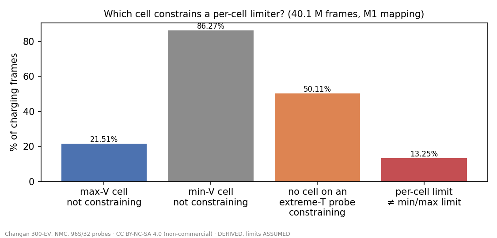
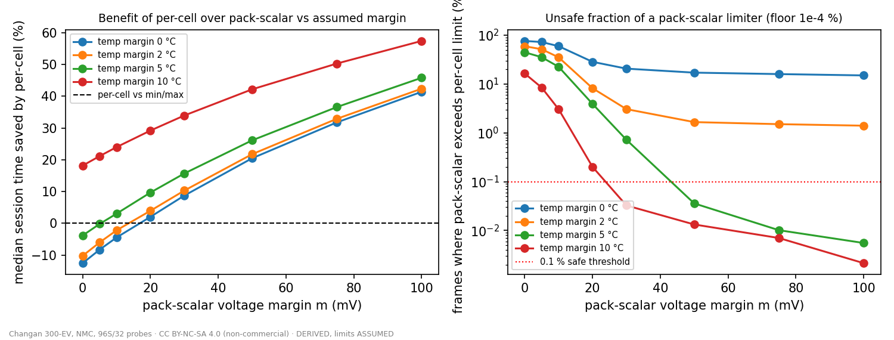
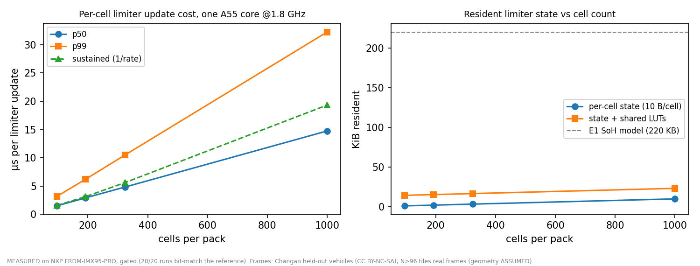

# Results H — per-cell limit enforcement: control headroom (replay) and compute cost (board)

Experiment H, run 2026-10-14.

- Pre-registration: [`H_preregistration.md`](H_preregistration.md), commit `43485e8`, committed before any H code.
- Brief: [`Experiment G and H Brief.md`](../../Experiment%20G%20and%20H%20Brief.md).

**H-a and H-b are separate results and do not share a headline:**

- **H-a** is a DERIVED replay. It runs on Changan 300-EV data (NMC, 96 series cells, 32 temperature probes). That
  data is **CC BY-NC-SA 4.0, so the result is non-commercial only**, and every limit in it is ASSUMED.
- **H-b** is MEASURED on the NXP FRDM-IMX95-PRO.

No regulatory, economic or real charge-rate claim is made.

## Verdicts

| | Verdict |
|---|---|
| **H-a (DERIVED)** | **NO BENEFIT over min/max.** On recorded cell states, a per-cell limiter would allow a median **0.008 %** shorter charge than a limiter that reads only the min/max scalars (95 % CI 0.004–0.011 %, M1 mapping; M2 median 0.008 %). That is far below the pre-registered 1 %. Both beat a **pack-mean-only** limiter by a large margin, but min/max captures that benefit already. |
| **H-b (MEASURED, gated)** | Per-cell limit enforcement costs **1.50 µs per update at 96 cells and 14.75 µs at 1,000 cells** (p50, one Cortex-A55 core at 1.8 GHz). Resident state is **10 B per cell plus 13.6 KB of shared tables**: 14.6 KB at 96 cells, 23.6 KB at 1,000. That is a small fraction of one A55 core. |

## H-a — counterfactual replay (every number DERIVED; limits, mapping and trajectory ASSUMED)

**Scope:** 300 vehicles, 286,832 charging sessions, 40.1 M charging frames that carry a full per-cell vector.

**Limit map (ASSUMED, generic NMC shape):** allowed C-rate = `C_T(T) · taper(SOC)`.

- `C_T` is flat at 1.5 C between 25 and 40 °C, falls on the cold side (plating), and falls on the hot side
  (derating).
- `taper` is 1 up to 60 % SOC, then linear down to 0.05 C at 100 %.

### The key control: is per-cell telling the limiter anything min/max doesn't?

| Fraction of charging frames (tie-aware, M1) | |
|---|---|
| The max-voltage cell is **not** among the constraining cells | 21.5 % |
| The min-voltage cell is not among them (the brief's wording; the wrong extreme for charging) | 86.3 % |
| No cell on the coldest or hottest probe is constraining | 50.1 % |
| Per-cell limit ≠ min/max limit at all | 13.3 % |

**Reading the 21.5 %.** In 21.5 % of frames, the binding limit is a *temperature* limit, not a voltage one. Even so,
min/max scalars set the same limit in all but 13 % of frames, because `tmin`/`tmax` and `vmax` already bracket the
worst case.

Where the two differ, the per-cell gain over min/max is tiny in charge-time terms:

| Per-cell over min/max | Median session | p90 | Max |
|---|---|---|---|
| Time saved | 0.008 % | 1.5 % | 21 % |

### Where the gain lives (post-hoc breakdown — not pre-registered)

The gain sits almost entirely in sessions charged outside the flat 25–40 °C band of the assumed map:

| Coldest probe during the session | Sessions | Median time saved | p90 |
|---|---|---|---|
| < 10 °C | 2,855 | 0.70 % | 4.3 % |
| 10–20 °C | 18,351 | 0.93 % | 3.7 % |
| 20–25 °C | 38,397 | 0.88 % | 2.9 % |
| **25–40 °C** | **226,690 (79 %)** | **0.00 %** | 0.6 % |
| ≥ 40 °C | 539 | 3.30 % | 9.2 % |

**This fleet charges mostly in warm conditions.** The median probe temperatures while charging are 28–31 °C, and the
median spread across probes is 3 °C. So the fleet-wide null is partly a statement about this climate and about the
assumed flat band. In cold or hot conditions the replay suggests a ~1–3 % gain, but even there it falls short of
the pre-registered threshold at the median.

### Sensitivity (pre-registered, M1, median session saving over min/max)

| Variant | Median saving |
|---|---|
| Temperature breakpoints shifted −5 °C | 0.22 % |
| Temperature breakpoints shifted +5 °C | 0.48 % |
| Taper knee at 50 % SOC | 0.05 % |
| Taper knee at 70 % SOC | 0.00 % |

No variant reaches 1 %.

### Against a pack-mean-only limiter (the brief's "conservative margin" sweep)

A limiter that sees only the pack mean voltage and mean temperature must add margins to stay safe.

- **Margins that are too small are unsafe.** With `m` = 0 mV and `mT` = 0 °C, the pack-mean limiter would exceed the
  per-cell limit in **76 %** of frames.
- **The smallest margins with ≤ 0.1 % unsafe frames** are (30 mV, 10 °C) and (50 mV, 5 °C). At those margins,
  limiting by the cell extremes would charge a median **34 %** and **26 %** faster respectively.
- **Every number here is a function of the assumed map and margins,** which is why this is a curve and not a figure.
  The benefit is from *extremes* information, which min/max scalars already provide.

### Verdict (pre-registered rule)

Median `S_mm` < 1 % under M1 (0.008 %) and under M2 (0.008 %, 5–95 % range 0.005–0.010 %), so the verdict is
**NO BENEFIT over min/max**. On this fleet and under these assumed limits, the constraining information sits in
`vmax`, `tmin` and `tmax`, which a GB/T-32960 scalar frame already carries.

**Hard honesty note:** this is what a limiter *would have allowed* on recorded states, with the trajectory held
fixed. It is not a measured charge rate and not a claim that any pack could safely charge faster.

## H-b — compute footprint at loop rate (MEASURED, gated in the same run)

**Set-up:**

- **Board:** NXP FRDM-IMX95-PRO, confirmed via `/proc/device-tree/model`.
- **CPU:** pinned to Cortex-A55 core 3, `performance` governor at 1.8 GHz.
- **Build:** gcc 15.2 `-O2`, single thread.
- **Board hygiene:** hard reservation held; census before and after (`results/H/board/`); 5 repeats per N.

**Workload per update:**

- ingest N cell voltages and ⌈N/3⌉ probe temperatures;
- compute the per-cell SOC-taper × temperature limit;
- take the min and argmin to find the constraining cell;
- emit the setpoint;
- update a per-cell EWMA resistance estimate.

**Frames:** real charging frames from held-out Changan vehicles (id ≡ 0 mod 10). Packs with N > 96 tile real frames
together, so their geometry is ASSUMED.

| Cells (N) | p50 µs | p99 µs | Sustained updates/s | Resident state | State + LUTs |
|---|---|---|---|---|---|
| 96 | **1.50** | 3.17 | 635,540 | 968 B | 14.6 KB |
| 192 | 2.92 | 6.21 | 318,927 | 1,928 B | 15.5 KB |
| 324 | 4.83 | 10.50 | 178,031 | 3,248 B | 16.9 KB |
| 1000 | **14.75** | 32.25 | 51,743 | 10,008 B | 23.6 KB |

**Reading the table:**

- **Repeatability.** The p50 range across the 5 repeats is ≤ 1 ns at every N; p99 varies by ≤ 1.5 %.
- **Spikes.** The worst single update was 57–724 µs. These look like scheduler preemptions, since the board was not
  isolated from its OS.
- **p99 ≈ 2.1 × p50,** consistent with the 6 % of frames that also run the resistance update (|ΔI| > 5 A).
- **Scaling** is linear: about 14.7 ns per cell at p50.
- **Memory.** VmHWM minus RSS-before-state is 80–868 KB, bimodal from run to run. That spread is page-granular harness
  noise (timing arrays, stdio), not limiter state. The exact resident state is the byte count in the table.

**Resident per cell (10 B):**

| Field | Size |
|---|---|
| Last voltage | 2 B |
| Resistance estimate | 4 B |
| Probe index | 2 B |
| Voltage limit | 2 B |

The shared tables are a 2,001-entry voltage→taper table and a 1,401-entry temperature→C table, both float32.

**Gate: 20 / 20 runs PASS.**

- The constraining cell (argmin) is identical to the Python reference on 100 % of 10,000 frames, every N, every
  repeat.
- The setpoint difference is 0.
- The maximum resistance-state difference is 4.8e-7. The likely cause is fused multiply-add on aarch64; it is within
  the 1e-3 tolerance.

**In context (DERIVED from MEASURED):**

- At a 10 ms control period (100 Hz), a 1,000-cell pack uses about **0.3 % of one A55 core** at p99.
- 96 cells uses about 0.03 %.
- For comparison, the SoH model from Experiment E1 is 225,544 B with 22.8 ms int8 p50 inference.
- **Per-cell limit enforcement is about 1,500 × (1,000 cells) to 15,000 × (96 cells) cheaper per call than that inference, and its state is about
  10–15 × smaller.** It is not a sizing driver for an A55 + DDR-class part. Even at 1,000 cells, the state fits in
  L1/L2.

## Deviations and disclosures

1. **The brief's control named the min-voltage cell.** For charging, the binding cell is the **max**-voltage cell.
   Both are reported, as stated in the pre-registration §0.
2. **The pre-registration's "differs" test had a typo.** It read `L_cell < L_mm − 1e-9`, which is impossible because
   `L_cell ≥ L_mm` by construction. The first run therefore reported 0 %. Corrected to `|L_cell − L_mm| > 1e-9`.
3. **NaN handling (not pre-registered).** The first run carried NaN currents into the time sums, so every saving came
   out NaN. Fix: NaN current contributes 0 Ah, and frames with NaN voltage or temperature are dropped (0 dropped).
   The verdict was computed only after this fix; no threshold changed.
4. **The constraining-cell control is now tie-aware.** At SOC ≤ 60 % every cell can share one limit, so a raw argmin
   index is arbitrary. A reference cell counts as constraining if its own limit equals the minimum. The raw-argmin
   figures are also in `replay.json`; they are tie-polluted, at 55 % / 99.8 % / 69 %.
5. **`L_mm` reads the extremes from the cell list rather than the scalar columns.** On synced frames these agree
   within 0.5 mV, and ±0.5 °C after the probe deviations were rounded. This guarantees `L_cell ≥ L_mm`.
6. **The temperature-band breakdown is post-hoc.**
7. **The cell-to-probe mapping is unknown (ASSUMED).** M1 (contiguous) and M2 (100 random permutations) give the
   same verdict.

## What would change the H-a answer

The verdict depends on three things:

- **Climate.** Most of this fleet's charging sits in the flat part of the assumed temperature map.
- **The real limit map.** The OEM's own plating map is not public.
- **Whether per-cell limits genuinely differ between cells.** For example, per-cell aged capacity or resistance
  would change the taper for each cell individually. This replay gave every cell the same map.

A cold-climate fleet, or a pack with known per-cell ageing differences, would be the right next test. So would any
instrumented data from a controller that actually enforced per-cell limits.

**Licence:** H-a and the H-b gate frames are Changan-derived (CC BY-NC-SA 4.0, non-commercial). The H-b latency and
memory figures are measurements of our own code on our own board. **No regulatory or economic consequence is claimed
or implied.**

## Post-review addendum (2026-10-15, independent review)

See [`review_2026-10-15/REVIEW.md`](../review_2026-10-15/REVIEW.md). The original text above is unchanged except where marked.

1. **The H-a verdict stands within its assumed map, but the design could not show the main mechanism.**
   - `L_cell ≥ L_mm` holds by construction.
   - One shared map for every cell excludes per-cell R and capacity differences, which is the main physical argument
     for per-cell limiting.
   - A post-hoc per-cell-R limiter from Changan current steps gains median +2.0 % (p90 +4.4 %) admissible current at
     vmax ≥ 4.0 V (reviewer, 38 vehicles).
2. **The pack-mean comparison is a weak baseline.**
   - GB/T frames already carry min/max and their indices.
   - The 26–34 % is mostly the 10 °C margin derating `C_T` at 18–21 °C.
   - "Faster" should read "shorter charge time".
3. **Board numbers: corrections and gaps.**
   - Every latency is a multiple of 41.67 ns, a 24 MHz counter. So "≤ 1 ns" repeatability is timer quantisation.
   - The p99 repeat spread is up to 2.0 % (N = 324), not ≤ 1.5 %.
   - The R-update branch runs on 27 % of frames at N = 1000, not 6 %.
   - Not measured: ingest/parse cost, RT isolation, and the M7/M33 cores.
4. **The cold-band numbers (< 10 °C, 2,855 sessions) are the natural next test,** together with per-cell parameters.
