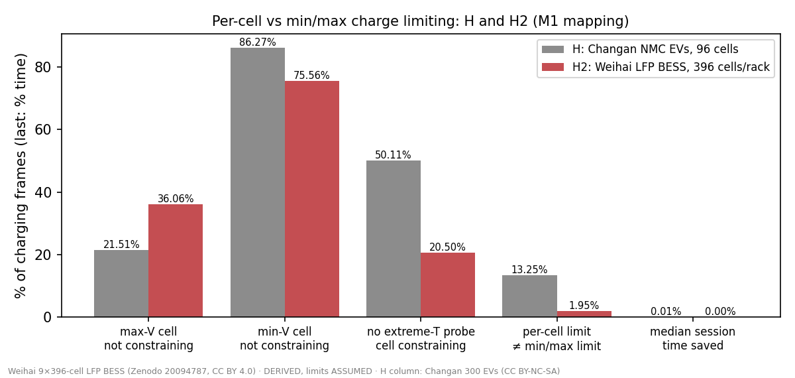
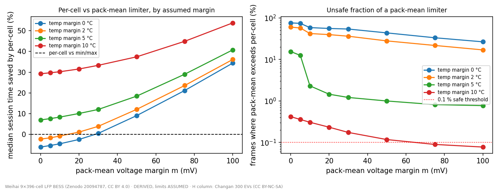

# Results H2 — per-cell charge limiting re-run on a 3,564-cell LFP grid battery (Weihai BESS)

Experiment H2, run 2026-10-15.

- **Pre-registration:** [`H2_preregistration.md`](H2_preregistration.md), commit `bf6ca52`. It was committed before
  any replay code existed.
- **Data:** Qu et al. (SJTU), Zenodo 20094787, **CC BY 4.0**. That makes these results **not** non-commercial-limited,
  unlike H, which ran on Changan.
- **What H2 is:** a re-run of Experiment H on a different chemistry (LFP), a 4× longer series string (396 cells per
  rack), and an 8-month run from Oct 2024 to May 2025.
- **Two parts with separate headlines:** H2-a is **DERIVED**, with every limit **ASSUMED**; H2-b is **MEASURED** on
  the FRDM-IMX95-PRO.
- No regulatory, economic or real charge-rate claim is made.

## Verdicts

| | Verdict |
|---|---|
| **H2-a (DERIVED replay)** | **NO BENEFIT over min/max**, more emphatically than in H. The median session saving of a per-cell limiter over a min/max limiter is **0.00 %** under M1 (bootstrap CI 0.00–0.00 %) and also 0.00 % under M2. p90 is 0.08 %; max 5.1 %. |
| **H2-b (MEASURED, gated 10/10)** | Per-cell limit enforcement at real geometry costs **5.83 µs per update for one 396-cell rack** and **52.1 µs for the whole 3,564-cell cluster** (p50, one A55 core at 1.8 GHz). Resident state is 10 B per cell plus 13.6 KB of tables. |

## H2-a — replay (DERIVED; limits, mapping and zero-order hold ASSUMED)

**Scope.**

- 217 charge operations × 9 racks gave **1,929 rack-sessions** and 1.59 M 10-second frames, delivering 404 kAh in
  total.
- 24 rack-sessions were unusable: their series never all logged before the operation ended (see deviations).

**Assumed limit map.** H's temperature curve `C_T`, multiplied by an LFP *voltage* taper: 1.0 up to 3.40 V, falling to
0.05 at 3.60 V, and 0 at 3.65 V.

### Why the answer is "no benefit" here

1. **The container is climate-controlled.** The pre-registered cold-weather test could not run:

| Charging conditions | p5 | Median | p95 |
|---|---|---|---|
| Coldest probe | 20 °C | 24 °C | 28 °C |
| Hottest probe | 23 °C | 27.5 °C | 31 °C |
| Probe spread | — | 4 °C | — |

   - **Not one session** had its median coldest probe below 10 °C, even through a Shandong winter.
   - The < 10 °C band holds 0 sessions and the 10–20 °C band holds 69, so H's open question, "does per-cell help
     in the cold?", **cannot be answered on this system**. That is not a "no".
2. **The cells rarely reach the taper.** The median top cell during charging sat at 3.377 V, below the 3.40 V knee,
   and the median cell spread was only 12 mV.
3. **Most of the time every cell gets the same limit,** so per-cell and min/max agree. They differ on only **1.95 %**
   of frames; in H that figure was 13.3 %.

| Fraction of charging frames (tie-aware, M1) | H2 (LFP BESS) | H (Changan EVs) |
|---|---|---|
| Max-V cell not among the constraining cells | 36.1 % | 21.5 % |
| Min-V cell not among them | 75.6 % | 86.3 % |
| No cell on the coldest or hottest probe is constraining | 20.5 % | 50.1 % |
| **Per-cell limit ≠ min/max limit** | **1.95 %** | 13.3 % |
| **Median session time saved (per-cell over min/max)** | **0.00 %** | 0.008 % |

### Pre-registered secondary analyses

**Temperature bands**, by the session's median coldest probe:

| Coldest probe | Sessions | Median saving | p90 |
|---|---|---|---|
| < 10 °C | 0 | — | — |
| 10–20 °C | 69 | 0.00 % | 0.00 % |
| 20–25 °C | 1,067 | 0.00 % | 0.18 % |
| 25–40 °C | 793 | 0.00 % | 0.00 % |
| ≥ 40 °C | 0 | — | — |

**Sensitivity** (M1, median saving): breakpoints shifted −5 °C gave 0.00 %; +5 °C gave 0.13 %. Knee at 3.35 V gave
0.07 %; knee at 3.45 V gave 0.00 %. **No variant comes near 1 %.**

**Against a pack-mean-only limiter** (the margin sweep):

- With no margins, the pack-mean limiter exceeds the per-cell limit in **76 %** of frames, the same figure as in H.
- The smallest margins with ≤ 0.1 % unsafe frames are **75 mV / 10 °C** and **100 mV / 10 °C**. That is wider than
  H's 30 mV / 10 °C, even though the cell spread here is small.
- At **75 mV / 10 °C**, limiting from extremes would charge a median **45 %** faster than the pack-mean limiter. At
  100 mV / 10 °C the figure is 54 %.
- **The benefit again comes from *extremes* information, which min/max scalars already carry.**

## H2-b — compute footprint at real geometry (MEASURED, gated)

**Set-up.** The same procedure as H-b:

- NXP FRDM-IMX95-PRO, verified from `/proc/device-tree/model`;
- hard reservation, with a census before and after (`results/H2/board/`);
- A55 core 3 pinned, `performance` governor at 1.8 GHz; gcc 15.2 `-O2 -DVLIM=3650`;
- 5 repeats per N, and 10,000 real Weihai charging frames per N.

The probe count is the real one: 216 probes per 396 cells, and 1,944 per 3,564.

| Cells (probes) | p50 µs | p99 µs | Sustained updates/s | Resident state | State + LUTs |
|---|---|---|---|---|---|
| 396 (216): one rack | **5.83** | 11.9 | 165,765 | 3,968 B | 17.2 KB |
| 3,564 (1,944): whole cluster | **52.1** | 107.0 | 18,446 | 35,648 B | 48.1 KB |

**Repeatability.** The p50 spread across repeats is ≤ 42 ns; p99 varies ≤ 0.2 %. The worst single update was
61–217 µs, which looks like OS preemption.

**Scaling** is about 14.7 ns per cell. This matches H-b's 14.7 ns per cell on synthetic geometry, so H's linear
scaling holds at 3.5 k cells with real probe counts.

**Gate: 10 / 10 PASS.** The argmin was identical to the Python reference in 100 % of frames. The setpoint difference
was 0, and the maximum R difference was 2.4e-7.

**In context (DERIVED from MEASURED):** at a 100 Hz control loop, the whole 3,564-cell cluster uses about **1.1 % of
one A55 core** (p99), and one rack uses about 0.12 %. The state stays far below L2.

## Deviations and disclosures

1. **24 rack-sessions were dropped** from 1,953 because they were empty: at least one of their 612 series had not
   logged before the operation ended, or fewer than 30 grid frames were left. This follows the pre-registered rule;
   the count was not known in advance.
2. **Board code generalised, plus one change not in the pre-registration.**
   - As pre-registered, `board/h_limiter.c` and `board/h_ref.py` now take the probe index as `⌊k·P/N⌋`. That is
     identical to H's `k/3` at N = 96, P = 32.
   - **Not in the pre-registration:** `VLIM` became a compile-time define, set to 3650 for LFP. Its default is still
     4250, so H's runs are unchanged.
3. **H2-b per-frame current** came from the grid dAh (I = −dAh · 360 A). This only affects which frames trigger the
   resistance-update branch. It matches the role that real current played in H-b's frames.
4. **Pre-registered cold-weather analysis is unanswerable** on this system, because of container thermal management.
   This is reported as "unanswerable", not as a null.
5. **The timestamp decoder (`analysis/mcos_dt.py`) is our own.** It is validated by matching the decoded timestamp
   count to the value count, and by monotone timestamps, for every series used.

## What H and H2 together say

- **Across two chemistries,** NMC EVs and an LFP BESS, and string lengths of 96 and 396, a per-cell charge limiter
  allows **no meaningful faster charging than a min/max limiter** under generic assumed limit maps.
- **Both datasets lack the one condition** where theory says per-cell could matter: large temperature gradients
  inside the pack in cold conditions.
  - The Changan EVs charge warm (79 % of sessions at 25–40 °C).
  - The Weihai container is held at 20–31 °C.
- **Pack-mean-only limiting is consistently unsafe without large margins.** Extremes information (min/max) recovers
  26–54 % charge time over a safely-margined pack-mean limiter.
- **The compute cost is trivial at grid scale:** about 52 µs per update for 3,564 cells on one A55 core.

**Licence:** H2 uses only CC BY 4.0 data and our own board measurements.

## Post-review addendum (2026-10-15, independent review) — **margin-sweep result withdrawn**

See [`review_2026-10-15/REVIEW.md`](../review_2026-10-15/REVIEW.md). The original text above is unchanged except where marked.

1. **The pack-mean margin result (75–100 mV / 10 °C; 45–54 %) is an artefact of stale cell data** (✔ reproduced by
   the main session).
   - Frames with any cell more than 100 mV from the median:

| Month | Such frames |
|---|---|
| November 2024 | **44,905** |
| Any other month | ≤ 515 |

   - The cause is series that log once and then stay stale for about 37 h, or whose only log predates StartTime.
     These pass the "has logged" guard in `analysis/H2_replay.py:75-76`.
   - Excluding them (reviewer recomputation), the safe margin is **30 mV / 10 °C, median 33 %, the same as H**.
   - The statement "wider than H's" is withdrawn.
   - **The primary NO BENEFIT verdict is unaffected**, because stale-low cells never set vmax.
2. **A staleness screen is needed before any re-run.** Healthy series are never older than 590 s, against a 600 s
   heartbeat. Weihai logs periodically (about 60 s, staggered), not by change with a deadband as the
   pre-registration assumed.
3. **Deviation 1 is partly wrong.** Rack 3's empty session is missing rack current, not cell series.
4. **H2-b corrections.**
   - Gate frames are the first 2,500 s of each op, so the taper is active in only 348 of 10,000 frames.
   - The p99 repeat spread is 0.35 % at N = 396, not ≤ 0.2 %.
   - Cost per cell is 14.6 ns, not 14.7.
