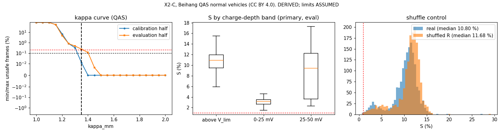

# Results X2-C: pre-registered confirmation of the per-cell-history charge-limit gain

Experiment X2-C, run 2026-10-28.

- **Pre-registration:** [`../X2C_preregistration.md`](../X2C_preregistration.md) and
  [`../X2C_profile.md`](../X2C_profile.md), commit `d27093f`. Both were committed before any limiter code.
- **Code:** `analysis/X2C_replay.py`. Outputs: `x2c.json`, `x2c_plots.png` and `run.log`.
- **Data:** Beihang QAS, 335 normal vehicles. κ was calibrated on 167 and the result scored on 168. **CC BY 4.0.**
- **Tags:** every number is **DERIVED**. Every limit (C_T map, V_lim 3.51 V, Q_ref 84.4 Ah) is **ASSUMED**. These
  are replay limiter currents, not charge rates.

## Verdict: NOT INTERPRETABLE, and the mechanism test fails anyway

**The pre-registered verdict (§6, checked in order) is NOT INTERPRETABLE.**

- κ_mm calibrated on the calibration half is **1.35**, with 0.012 % unsafe frames there.
- On the held-out evaluation half, min/max at that κ is unsafe in **0.24 %** of frames. The bar is ≤ 0.2 %.
- So the min/max limiter was not equally safe on held-out vehicles. By the pre-registered rule, the comparison cannot
  be read.

**If it were readable, it would fail the mechanism control.** The shuffle control gives the next verdict line,
**MECHANISM UNCLEAR**.

| QAS evaluation half, primary population (1,621 sessions, 106 vehicles) | Value |
|---|---|
| Median S (real per-cell R) | **+10.8 %** (vehicle-bootstrap CI 10.4–11.2 %) |
| Median S with **R_k shuffled across cells** | **+11.7 %** (CI 11.4–12.0 %) |
| Shuffled per-cell limiter "unsafe" against the true per-cell limiter | **70 %** of frames |
| Binding cell is not the max-V cell (true R) | 72 % of frames |

**Plain statement.** X2's +5.5 % is **not confirmed** on new data. X2-C also shows **why** the gain appears.

- A per-cell limiter with **wrong** cell assignments gains just as much, or slightly more, while exceeding the true
  per-cell limit in 70 % of frames.
- So S is not measuring the value of knowing which cell is worst. **It measures the margin asymmetry built into the
  comparison.**
  - The per-cell limiter carries no κ margin.
  - "Unsafe" is defined relative to the per-cell limiter itself, so it is safe by construction.
  - Min/max must carry κ = 1.35–1.65 to match it.
- The design rewards any margin-free limiter, correct or not.

This was disclosed as a possibility in the pre-registration (§5, "disclosed prior to the contrary").

## Sensitivity (all pre-registered; κ recalibrated on the calibration half each time)

| Variant | κ (cal) | Realised unsafe (eval) | Primary n | Median S | Shuffle median S | Reading |
|---|---|---|---|---|---|---|
| **Base** | 1.35 | **0.24 %** | 1,621 | 10.8 % | 11.7 % | NOT INTERPRETABLE |
| Window 7 days | 1.35 | 0.24 % | 1,621 | 10.7 % | 11.6 % | as base |
| Window 90 days | 1.35 | 0.24 % | 1,621 | 10.8 % | 11.7 % | as base (identical, as predicted) |
| Step 0.2 C | 1.35 | 0.24 % | 1,624 | 10.9 % | 11.7 % | as base |
| Step 0.5 C | 1.35 | 0.23 % | 1,592 | 10.7 % | 11.6 % | as base |
| V_lim −20 mV | 1.35 | 0.22 % | 1,641 | 10.8 % | 11.7 % | as base |
| V_lim +20 mV | 1.35 | 0.25 % | 1,604 | 10.7 % | 11.5 % | as base |
| Depth 25 mV | 1.35 | 0.24 % | 1,599 | 10.8 % | 11.7 % | as base |
| Depth 100 mV | 1.35 | 0.24 % | 2,136 | 10.8 % | 11.7 % | as base |
| κ tolerance 0.01 % | 1.40 | **0.12 %** (interpretable) | 1,621 | 13.2 % | **14.1 %** | **MECHANISM UNCLEAR** |
| κ tolerance 1 % | 1.25 | 0.82 % | 1,621 | 5.5 % | 6.4 % | not interpretable |

**Readings from the table:**

- **The shuffle beats the real limiter in every variant.**
- **The one variant where held-out safety passes is MECHANISM UNCLEAR.**
- **S tracks κ, not R.** Tightening the margin from 1.25 to 1.40 moves S from 5.5 % to 13.2 %.

**κ curves.** Held-out vehicles need κ 1.45 to meet 0.1 %, against 1.35 on the calibration half. The curves are steep
between 1.2 and 1.45, where 0.05 of κ moves the unsafe fraction by a factor of 3–10.

**By charge depth** (base, primary):

| Sessions | Median S |
|---|---|
| Above V_lim | 10.9 % |
| 0–25 mV below V_lim | 3.3 % |

## Controls

| Control | QAS | Comparison |
|---|---|---|
| **Split-half R_k stability** (all steps per vehicle) | ρ median **0.99** (p10 0.98); same worst cell in 71 % of vehicles; worst/median R_k 1.21 | Changan: 0.98 / 81 % / 1.20 |
| **Binding cell not max-V** | 72 % of frames | — |
| **Shuffle** | Fails: shuffled ≥ real | — |

- **Split-half.** The per-cell R pattern is real and stable. **The failure is not noise in R.** The comparison cannot
  credit R_k to the right cell.
- **Binding cell.** Per-cell R does change which cell binds, so information is present. But S does not reward
  getting it right.

## Secondary arms

| Arm | Result |
|---|---|
| **DTI** (35 eval vehicles in primary, 1,291 sessions) | κ 1.20; realised unsafe on eval **0.37 %**, so **NOT INTERPRETABLE**. S 1.9 % (CI 1.6–2.5 %), shuffle 2.1 %, so it would also be MECHANISM UNCLEAR. Binding-not-max-V 9 %. Split-half ρ 0.95. |
| **McMaster** (carried over from X2-M2, not re-run) | 0.00 % at the SOURCED 6 C, descriptive |
| **BatICM sampling case** (report-only) | car1 at native 1 s: median R_k = **0.0 mΩ** over 7,028 steps. Cell voltages did not move across most 1 s current steps, which suggests the cell scan refreshes slower than the current channel (not verified). Decimated to 30 s: R 0.08 mΩ, split-half ρ 0.47. car4 at native 30 s: R 0.35 mΩ, ρ 0.83. **Faster sampling did not give a usable R here.** Per-cell R needs cell voltage and current sampled together, which these BMS logs do not guarantee. |

## What this does to the programme

1. **The only accuracy-type positive left is withdrawn.**
   - X2's +5.5 % (Changan, post-hoc) is not confirmed.
   - The X2-C shuffle shows that the X2 design rewards a margin-free limiter regardless of cell assignment.
   - X2 had no shuffle control, so **its +5.5 % should be read as margin asymmetry**, until a Changan shuffle shows
     otherwise. That would be post-hoc on seen data, so it is a diagnostic only.
2. **A fair comparison needs a different safety reference.** The per-cell limiter must carry its own margin for R
   estimation error, calibrated the same way. Alternatively, "unsafe" must be judged against something other than
   the per-cell estimate, such as a held-out R from disjoint steps. That would be a new pre-registration.
3. **What survives:**
   - per-cell R is a **stable, measurable per-cell property** (ρ 0.99, Beihang);
   - per-cell R changes which cell binds in about 70 % of frames near top of charge;
   - its value for charge limiting is **unmeasured**, not shown.

## Deviations

None after `d27093f`. All thresholds were applied as pre-registered.

**Implementation notes (as stated in the pre-registration):**

- The shuffle permutation uses `default_rng(vehicle ID)`. That is "seed 0 + vehicle ID" as pre-registered.
- BatICM car1 R used all native rows with no valid-row filter beyond non-null values, as written.

**Licence:** Beihang and McMaster are CC BY 4.0; BatICM is MIT. No Changan data was used, so these results are
commercially citable.
