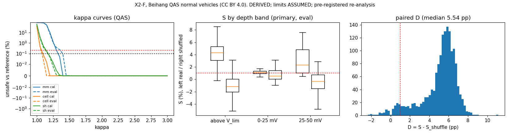

# Results X2-F: a fair comparison of per-cell and min/max charge limiting

Experiment X2-F, run 2026-10-28.

**This is a pre-registered re-analysis, not a confirmation on unseen data.** The Beihang data had already been used by
X2-C. What X2-F changes is the comparison:

- every limiter carries its own margin, calibrated the same way;
- safety is judged against a per-cell reference built from steps that none of the limiters sees.

| | |
|---|---|
| **Pre-registration** | [`../X2F_preregistration.md`](../X2F_preregistration.md), commit `6cbfeb8`, committed before any X2-F code |
| **Code** | `analysis/X2F_replay.py` |
| **Outputs** | `x2f.json`, `x2f_plots.png`, `run.log` |
| **Data** | Beihang QAS, 335 normal vehicles, X2-C's split: κ calibrated on 167 vehicles, scored on 168. **CC BY 4.0.** |
| **Tags** | Every number is **DERIVED**. Every limit is **ASSUMED**. These are replay limiter currents, not charge rates. |

## Verdict: NOT INTERPRETABLE, by a narrow margin

The pre-registered verdict (§6) is **NOT INTERPRETABLE**.

- **Min/max fails held-out safety again.** Calibrated at κ_mm 1.35 on the calibration half (0.05 % unsafe frames), it
  is unsafe in **0.23 %** of evaluation-half frames against the reference. The bar is 0.2 %.
- **The per-cell and shuffled limiters both pass held-out safety:**
  - per-cell (κ_c 1.10): 0.08 % on calibration, **0.03 %** on evaluation;
  - shuffled (κ_s 1.20): 0.05 % on calibration, **0.05 %** on evaluation.

**Unlike X2-C, the mechanism control now works.** If it could be read, the base case would read CONFIRMED.

| QAS evaluation half, primary population (1,607 sessions, 106 vehicles) | Median | Vehicle-bootstrap CI |
|---|---|---|
| **S** (per-cell against min/max) | **+4.2 %** | 3.8–4.5 % |
| **S_sh** (shuffled per-cell against min/max) | **−1.1 %** | −1.4 to −0.7 % |
| **D = S − S_sh**, paired per session | **+5.5 pp** | 5.3–5.7 pp |
| S_ref: an exact, margin-free per-cell limiter (ceiling) | +10.7 % | |
| Binding cell not the max-V cell | 75 % of frames | |

**Plain statement.** Once every limiter must carry its own margin against an independent reference:

- **Getting the cell assignment right is worth something.** A shuffled per-cell limiter is now **slower** than
  min/max. The real one is faster, and the paired gap is about 5.5 pp in the base case. That is the opposite of X2-C
  and of the Changan shuffle diagnostic.
- **The size of the gain over min/max is not established.**
  1. The comparison is not interpretable, because min/max's margin does not transfer to held-out vehicles.
  2. S swings with the 0.05 κ grid step, between about 1 % and 4–5 % (sensitivity, below).
  3. In the one variant where all three limiters are held-out safe (tolerance 0.01 %), S is **+0.6 %, below the 1 %
     bar**.

## What the margins themselves show (reported, not deciding)

The κ each limiter needs, measured against the same independent reference, is the cleanest reading in this experiment.

| Unsafe frames, calibration % / evaluation % | κ 1.05 | κ 1.10 | κ 1.15 | κ 1.20 | κ 1.30 | κ 1.35 | κ 1.40 |
|---|---|---|---|---|---|---|---|
| **Per-cell** | 0.44 / 0.48 | **0.08 / 0.03** | 0.02 / 0 | 0 / 0 | 0 / 0 | 0 / 0 | 0 / 0 |
| **Shuffled** | 3.6 / 2.8 | 0.53 / 0.40 | 0.18 / 0.15 | **0.05 / 0.05** | 0.005 / 0.001 | 0 / 0 | 0 / 0 |
| **Min/max** | 86.7 / 85.9 | 84.0 / 82.8 | 53.4 / 52.7 | 10.2 / 7.9 | 0.21 / 0.38 | **0.05 / 0.23** | 0 / 0.09 |

- **The ordering is per-cell < shuffled < min/max at every κ until all reach zero, on both halves.** Real per-cell R needs about a 10 %
  margin to be safe against an independent per-cell estimate. Wrong cell assignments need about 20 %, and a
  pack scalar needs 35–45 %.
- **The per-cell margin transfers to held-out vehicles; the min/max margin does not.** Per-cell is 0.08 % →
  0.03 %. Min/max is 0.05 % → 0.23 % at κ 1.35. This is why the verdict is NOT INTERPRETABLE. It is also, on its own, a
  point in favour of per-cell limiting: its margin is smaller **and** more predictable.

## Sensitivity (all pre-registered; κ recalibrated on the calibration half each time)

| Variant | κ_mm / κ_c / κ_s | Held-out unsafe, mm / cell / sh (%) | Primary n | S | S_sh | D | Reading |
|---|---|---|---|---|---|---|---|
| **Base** | 1.35 / 1.10 / 1.20 | **0.23** / 0.03 / 0.05 | 1,607 | **+4.2 %** | −1.1 % | +5.5 pp | NOT INTERPRETABLE |
| Step 0.2 C | 1.35 / 1.15 / 1.20 | 0.24 / 0 / 0.05 | 1,621 | +1.0 % | −1.0 % | +2.3 pp | NOT INTERPRETABLE |
| Step 0.5 C | 1.35 / 1.15 / 1.20 | 0.26 / 0 / 0.06 | 1,561 | +0.9 % | −1.2 % | +2.3 pp | NOT INTERPRETABLE |
| Reference from whole record | 1.35 / 1.15 / 1.20 | 0.25 / 0.02 / 0.02 | 1,607 | +1.0 % | −1.1 % | +2.2 pp | NOT INTERPRETABLE |
| Depth 25 mV | as base | as base | 1,585 | +4.2 % | −1.1 % | +5.5 pp | NOT INTERPRETABLE |
| Depth 100 mV | as base | as base | 2,114 | +4.2 % | −1.0 % | +5.6 pp | NOT INTERPRETABLE |
| **κ tolerance 0.01 %** | 1.40 / 1.20 / 1.30 | **0.09 / 0 / 0.001** (interpretable) | 1,607 | **+0.6 %** (CI 0.2–0.8) | −4.5 % | +5.2 pp | **NO BENEFIT** |
| κ tolerance 1 % | 1.30 / 1.05 / 1.10 | 0.38 / 0.48 / 0.40 | 1,607 | +4.8 % | +2.4 % | +2.4 pp | NOT INTERPRETABLE |

**Readings:**

- **D is positive in every variant, with every CI clear of zero (2.2–5.6 pp).** The mechanism holds throughout.
- **S is not robust.**
  - It is +4.2 % only where κ_c lands on 1.10. Where κ_c lands on 1.15 it is about +1 %, and at κ_c 1.20 it is +0.6 %.
  - The 0.05 grid step is coarse next to the effect. Per-cell's unsafe fraction at κ 1.10 (0.077 %) sits just under
    the 0.1 % calibration bar.
  - So the base +4.2 % depends partly on where the grid falls. The robust statement is "about +1 %, up to about +4 %".
- **The only fully interpretable variant reads NO BENEFIT: +0.6 %, under the 1 % bar.**

## Secondary arm: DTI (reported, same rules)

| DTI evaluation half (1,288 primary sessions, 35 vehicles) | Value |
|---|---|
| κ_mm / κ_c / κ_s | 1.40 / 1.25 / 1.30 |
| Held-out unsafe, mm / cell / sh | 0.10 % / 0.10 % / 0.07 %: **all interpretable** |
| S | **+1.1 %** (CI 0.9–1.4 %) |
| S_sh | +0.6 % |
| D | +0.6 pp (CI 0.5–0.8) |
| Binding cell not the max-V cell | 11 % of frames |
| Reading under the same rules | **MECHANISM UNCLEAR**: S passes 1 %, but D is under 1 pp |

On the NMC-like DTI fleet, the binding cell is almost always the max-V cell. Per-cell R therefore has little to change,
and the gain is small: positive, but just over the bar.

## What this does to the programme

1. **X2's design flaw is confirmed and fixed.**
   - With the circularity removed, a per-cell limiter given wrong cells' R loses to min/max (−1.1 %).
   - The X2 and X2-C gains, and the Changan diagnostic, all came from margin asymmetry.
   - X2-F is the first comparison in this programme where per-cell knowledge itself shows a measurable effect.
2. **What the data now supports.** These are DERIVED replay results on LFP-like QAS, and pre-registered re-analysis
   only.
   - Per-cell R is stable (ρ 0.99).
   - Getting the cell assignment right reduces the safety margin a limiter needs, from about 35–45 % (pack scalar) to
     about 10 %.
   - That smaller margin holds on held-out vehicles.
3. **What it does not support.** A charge-time claim. The admitted-current gain over an equally safe min/max is
   somewhere around +1 % to +4 % depending on grid placement, and it is not interpretable at the pre-registered
   tolerance. Where everything is interpretable, it is +0.6 %, below the bar.
4. **What would settle it.** Both of these need new data and a new pre-registration:
   - a **finer κ grid** (for example 0.01), so S stops jumping with grid placement;
   - a **min/max margin that transfers**, for example calibrated per vehicle, or with a held-out-safety target in
     calibration.

**Board.** None. The verdict is not CONFIRMED, so §9 is not triggered.

## Deviations

**DEV-1 (whole-record reference variant only).** The pre-registration defines E and F by parity **within** each window.
For the whole-record reference, F is every odd-index step of the vehicle's whole record. Local and global parity can
differ, so local-even E steps could also have been in F. To keep the two sets disjoint, that variant uses **global**
parity for E as well: E is the window steps with an even index in the whole record. The base case and all other
variants are as pre-registered.

No other changes. All thresholds were applied as pre-registered.

**Licence:** Beihang is CC BY 4.0, so these results are commercially citable.
