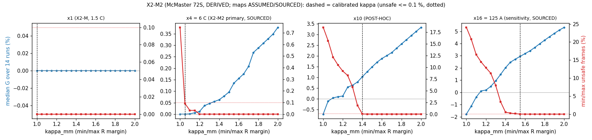

# Results X2-M2: McMaster 72S with a SOURCED power-cell current map

Experiment X2-M2, run 2026-10-16.

- **Pre-registration:** [`../X2M2_preregistration.md`](../X2M2_preregistration.md), commit `ea9f714`.
- **Code:** `analysis/X2_replay.py --arm mcmaster --mcm-qscale {4,16}`, with the figure from
  `analysis/X2M2_plot.py`.
- **Outputs:** `../X2/x2_mcmaster_M2_qscale4.json` and `../X2/x2_mcmaster_M2_qscale16.json`.
- **Tags:** all results are **DERIVED** from the McMaster telemetry, which is MEASURED by the dataset authors. The maps
  are SOURCED caps on H's ASSUMED temperature shape.
- **Licence:** CC BY 4.0, so this arm is commercially citable.

## Verdict (pre-registered, primary map 6 C)

**Descriptive: the interval spans 0.**

- Median G is **0.00 %**, with run-bootstrap CI 0.00–0.01 %.
- κ_mm is 1.05.
- At a 6 C cap, the voltage-headroom term binds in only **2.0 %** of charge-direction frames, so per-cell R almost
  never changes the limit. The highest single run is HWFET 15 °C, at +1.1 %.

## All maps

| Map | Status | κ_mm | Headroom binds (frames) | Median G | CI | Runs ≥ 0 |
|---|---|---|---|---|---|---|
| ×1 = 1.5 C | X2-M, pre-registered | 1.00 | about 0 % | 0.00 % | 0–0 | 14 / 14 |
| **×4 = 6 C** | **X2-M2 primary, SOURCED (dataset README)** | 1.05 | 2.0 % | **0.00 %** | 0.00–0.01 % | 12 / 14 (two at −0.02 % or less) |
| ×10 | POST-HOC (tried before X2-M2) | 1.40 | 21.4 % | +1.0 % | 0.3–3.0 % | 14 / 14 |
| ×16 = 125 A | X2-M2 sensitivity, SOURCED (Kim slide; cell attribution uncertain) | 1.55 | 27.3 % | **+3.0 %** | 2.6–4.0 % | 14 / 14 |

## Reading

**The X2 programme now has one consistent pattern.** Per-cell R from history buys current **only in proportion to how
often the voltage-headroom term binds**. How often it binds is set by the current cap, and on Changan by charge depth.

| Case | Headroom binds | Gain |
|---|---|---|
| McMaster, cap 6 C | 2 % of frames | 0 |
| McMaster, cap 125 A | 27 % of frames | +3 % |
| Changan warm sessions with history | median 58 % of frames | +5.5 % (post-hoc) |
| Changan cold sessions with history | 0 % | 0 |

**The κ curves show what the gain is.** Without margin (κ = 1.00), min/max is unsafe in 0.7–24 % of frames. The margin
needed to make it safe (κ 1.05–1.55) is what the per-cell limiter saves.

**How to cite this.**

- The commercially citable figure is **0 % at the dataset's own 6 C charge rate**.
- +3 % appears only if the pack really admits 125 A peaks, and that source is not tied unambiguously to this cell.
- Neither is a real charge-rate claim.

## Deviations

None after `ea9f714`.

- The code change only added output fields (`G_median_curve`, `head_frac_all`) and the output naming.
- The ×1 run was repeated to add the G curve. Every per-run G and κ is unchanged from X2-M.
