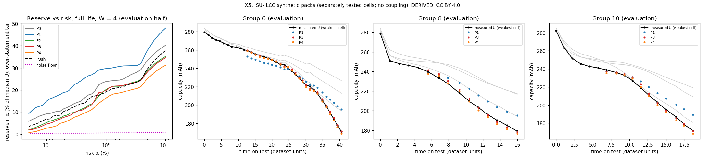

# Results X5: can per-cell history shrink an uncertainty reserve? (ISU-ILCC, clean labels)

Run 2026-10-30. **Caveat on every verdict:** *synthetic packs of separately tested cells; no thermal or electrical
coupling; an upper bound on what per-cell history can do.* Licence: ISU-ILCC **CC BY 4.0**.

| | |
|---|---|
| **Pre-registration** | [`../X5_preregistration.md`](../X5_preregistration.md): `059b818`, reviewer-approved, with D-1 and D-2 committed before estimator code at `bd7a2af` |
| **Code** | `analysis/X5_estimate.py` |
| **Outputs** | `x5.json`, `x5_targets_full.csv`, `x5_plots.png` |
| **Tags** | Every number is **DERIVED** from **MEASURED** lab labels (RPT C/5 capacity, label noise 0.24 %). The reserve is a statistic of prediction error. It is not a kWh, cost, range or regulatory figure. |

## Verdict: UNCLEAR, for both P3 and P4, in both readouts (D-1). 4× is not reached.

- Per-cell history reaches **exactly 1.5×** against the pack scalar at α = 1 %.
- **A shuffled control, which does not know which cell is which, gains just as much (1.55×).**
- So does an estimator that tracks only the weakest cell's own series (P2 / P3 = 1.02).

The gain over the pack scalar is real, but it comes from **watching the weakest cell's level and trend**. A min/max
view already does that. It does not come from **tracking each cell's identity over life**.

The full-life (a) and end-of-first-life (b) readouts agree.

| α = 1 %, over-statement tail | (a) Full life, **headline** | (b) Truncated at U < 0.8·U₀ (D-1, co-primary) |
|---|---|---|
| Scored evaluation targets / units | 374 / 31 | 224 / 29 |
| **G(P3) = r(P1) / r(P3)** | **1.50** (unit-bootstrap CI 1.29–2.49) | **1.51** (CI 1.17–2.61) |
| G(P4) | 1.82 (CI 1.48–3.03) | 1.63 (CI 1.00–2.42) |
| **Shuffle control G_sh** (bar: < 1.2) | **1.55** (CI 1.29–1.96): **fails** | **1.37** (CI 1.01–2.06): **fails** |
| P2 (weakest-cell series) vs P3 | 1.02 (CI 0.92–1.06) | 1.01 (CI 0.96–1.41) |
| Verdict, P3 / P4 | **UNCLEAR / UNCLEAR** | **UNCLEAR / UNCLEAR** |
| Reaches 4×? | No (P3 1.50, P4 1.82) | No (P3 1.51, P4 1.63) |

**Why UNCLEAR rather than PER-CELL HELPS:**

- P3 meets the gain bar (≥ 1.5) and its CI lower bound clears 1.
- But the pre-registered shuffle condition (G_sh < 1.2) fails in both readouts. The decision table puts that case in
  UNCLEAR.

## Reserve table (evaluation half, W = 4)

`r_α = q(1−α)(e) / median(U)`, with `e = U_pred − U_true`; over-statement is positive. "Under" is the brief's original
`q(1−α)(−e)` tail (P-3).

**(a) Full life** (median U as the reference):

| Estimator | MAE | r 5 % | r 1 % | r 0.1 % (extrapolated) | Under-tail r 1 % |
|---|---|---|---|---|---|
| P0, last U | 4.1 % | 11.7 % | 23.8 % | 40.2 % | −0.4 % |
| **P1, pack scalar** (ρ = 0.970 from calibration) | 5.7 % | 18.9 % | **29.6 %** | 47.9 % | 4.5 % |
| P1-h (own history ratio; not deciding) | 6.0 % | 19.1 % | 29.6 % | 49.7 % | 3.6 % |
| P2, weakest-cell series | 2.3 % | 8.2 % | 20.1 % | 35.1 % | 11.7 % |
| **P3, per-cell** | 2.2 % | 7.8 % | **19.8 %** | 34.5 % | 12.3 % |
| P4, per-cell + Q(V) ridge | 1.8 % | 5.4 % | 16.3 % | 31.1 % | 9.5 % |
| P3 shuffled | 3.0 % | 10.3 % | 19.1 % | 37.8 % | 11.7 % |
| Label-noise floor (Gaussian, σ 0.24 %) | — | 0.39 % | 0.55 % | 0.74 % | — |

**(b) Truncated at the end of first life:**

| Estimator | MAE | r 5 % | r 1 % | r 0.1 % (extrapolated) |
|---|---|---|---|---|
| P0 | 1.6 % | 3.4 % | 5.2 % | 7.8 % |
| **P1** (ρ = 0.985) | 1.3 % | 3.6 % | **5.7 %** | 5.8 % |
| P2 | 0.9 % | 1.8 % | 3.8 % | 5.3 % |
| **P3** | 0.9 % | 1.7 % | **3.8 %** | 4.8 % |
| P4 | 0.6 % | 1.7 % | 3.5 % | 5.6 % |
| P3 shuffled | 1.1 % | 2.0 % | 4.2 % | 5.5 % |

**Readings:**

- Every estimator is **far above the label-noise floor**. The reserve is set by unpredictable fade (knees), not by
  measurement noise.
- In the first-life readout, the P3 reserve at 1 % is about 7× the floor.
- P3 beats P1 in absolute error on 85 % of targets (a) and 69 % (b).
- P3 against P0 (G = r(P0)/r(P3)): 1.20 (a) and 1.37 (b).

## Controls

1. **Shuffle (P-2, cells permuted independently at every past check).**
   - Shuffled P3 has a slightly *lower* 1 % reserve than real P3 in (a): 19.1 % vs 19.8 %.
   - It is slightly higher in (b): 4.2 % vs 3.8 %.
   - Either way, the gain over P1 survives losing cell identity, so **it is not coming from tracking which cell is
     weakest**.
   - What drives it: P1 extrapolates the pack mean and scales it by a constant ratio. That misses how far the weakest
     cell has diverged (plot panels 2–4). Any estimator that sees the minimum at each check catches it.
2. **Label-noise floor:** see the reserve table. All estimators are about 6–55× above it.
3. **Pack-level truth** (target = unit mean capacity, r at 1 %):

   | Readout | P0 | P1 | P2 | P3 | P4 |
   |---|---|---|---|---|---|
   | (a) | 11.6 % | 8.3 % | 5.3 % | 8.3 % | 6.6 % |
   | (b) | 3.1 % | 1.1 % | 1.4 % | 1.1 % | 1.2 % |

   - Here **P3 = P1 = shuffled P3 by construction**: the mean of per-cell OLS trends is the OLS trend of the mean. A
     degeneracy found in the run, reported as such.
   - Against pack-level truth, per-cell history adds nothing. Its edge exists only for the weakest-cell target.

## Sensitivity (pre-registered; full life, α = 1 %)

| Variant | Targets | G(P3) | G(P4) | G_sh | P2 / P3 | Verdict, P3 / P4 |
|---|---|---|---|---|---|---|
| **Base, W = 4, warm-up 30 %** | 374 | **1.50** | 1.82 | 1.55 | 1.02 | UNCLEAR / UNCLEAR |
| W = 3 | 378 | 1.64 | 1.78 | 1.66 | 1.06 | UNCLEAR / UNCLEAR |
| W = 6 | 349 | 1.35 | 1.97 | 1.33 | 0.95 | UNCLEAR / UNCLEAR |
| Warm-up 20 % | 419 | 1.55 | 1.88 | 1.60 | 1.01 | UNCLEAR / UNCLEAR |
| Warm-up 40 % | 327 | 1.42 | 1.76 | 1.49 | 1.01 | UNCLEAR / UNCLEAR |
| P3 last value (P-4: equals P0) | 374 | 1.25 | 1.82 | 1.55 | 0.85 | UNCLEAR / UNCLEAR |

In every variant, **G_sh ≈ G(P3)** and **P2 ≈ P3**. The verdict never changes. In the last-value row, P0 / P3 = 1.00,
which confirms the degeneracy.

## D-2: reserve by within-group spread (descriptive, full life, α = 1 %)

| Spread at the target check | Targets | Units | r P1 | r P3 | r P3 shuffled |
|---|---|---|---|---|---|
| < 2 % | 21 | 9 | −1.6 % | 0.2 % | 0.5 % |
| 2–5 % | 98 | 27 | 0.8 % | 1.6 % | 1.8 % |
| 5–15 % | 129 | 29 | 8.5 % | 6.7 % | 7.4 % |
| > 15 % | 126 | 30 | 40.0 % | 30.1 % | 29.9 % |

- **Below 5 % spread, the pack scalar is as good or better.** That band holds most first-life checks.
- P3's advantage appears only once cells have diverged past 5 %, and there the shuffled version matches it.
- Bins have different median U. Each row's reserve uses its own median U.

## Plain statement

- **Does per-cell history reach 1.5×?** Against a pack-scalar estimator, nominally yes: 1.50 full life, 1.51 first
  life. But that gain needs only the weakest cell's measured capacity at each check (P2 matches P3), and it survives
  scrambling cell identity. **Tracking each cell's own history adds nothing measurable** beyond a min/max view.
- **Does anything reach 4×?** No. The best is P4 at 1.82, on a ridge model of Q(V) curve features, and it also does not
  clear the shuffle control.
- **What sets the reserve?** Unpredictable late-life knees. Reserves sit about 6–55× above the 0.24 % label-noise floor, so better
  labels would not help. Earlier warning of a cell's knee would.
- **For the reserve claim:** on the cleanest public per-cell data, history-based estimation does not deliver the ~4×
  precision a 20 % → 5 % reserve cut needs. Its gain over a naive pack scalar comes from observing the weakest cell,
  which a min/max BMS already does.
- **This is an upper bound.** These are synthetic packs with no coupling, and a real pack's weakest cell could behave
  differently.

*Left: reserve vs risk α for each estimator, with the label-noise floor. Right: weakest-cell capacity over life,
measured vs P1, P3 and P4, for the three pre-fixed example units (groups 6, 8 and 10). Grey lines are individual
cells.*

## Deviations and run notes

- **D-1, D-2:** reviewer additions, committed before estimator code (`bd7a2af`).
- **D-3 (alignment, found while coding, before any run).** In groups 20–29, `Q_interpolated` has one more column than
  `capacity_fade`. The extra column is entirely empty: the week-4 RPT the dataset README lists as lost. Dropping
  all-empty columns aligns every cell, and max Q(V) then matches the measured capacity within 0.1 % (median). No unit
  lost P4. No feature was imputed.
- **Pack-truth degeneracy:** P3 = P1 under pack truth by linearity of OLS (above). It was found in the run and is
  reported, not changed.
- **P1 ρ:** for (b), ρ was refit on the truncated calibration half (0.985), as D-1 specifies.
- **Board:** none.
