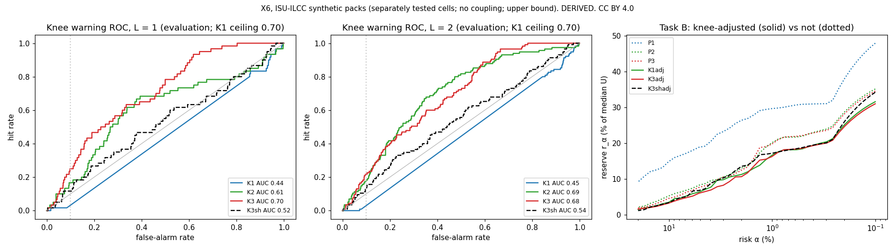

# Results X6: can history forecast a cell's knee before it arrives? (ISU-ILCC)

Run 2026-10-30. **Caveat on every verdict:** *synthetic packs of separately tested cells; no thermal or electrical
coupling; an upper bound.* Licence: ISU-ILCC **CC BY 4.0**.

| | |
|---|---|
| **Pre-registration** | [`../X6_preregistration.md`](../X6_preregistration.md): `2188950`, reviewer-approved, with D-1 and D-2 committed before forecasting code at `2881c7b` (public hashes) |
| **Code** | `analysis/X6_forecast.py` |
| **Outputs** | `x6.json`, `x6_taskB_targets.csv`, `x6_plots.png` |
| **Tags** | Every number is **DERIVED** from **MEASURED** lab labels. These are lab RPT steps, not field lead times. |

## Verdict: UNCLEAR. Warnings carry some per-cell signal, but they do not shrink the reserve.

| Decision condition (L = 1, full life, evaluation half) | Value | Bar | Met? |
|---|---|---|---|
| Knee events | 66 | ≥ 30 | yes |
| AUC(K3) − AUC(K1) | **+0.26** (unit-bootstrap CI 0.15 to 0.35) | ≥ 0.10, CI > 0 | yes |
| AUC(K3-sh) − AUC(K1) | **+0.08** (CI −0.03 to 0.19) | < 0.05 | **no** |
| Task B: G_B = r(K1-adj) / r(K3-adj) at α 1 % | **1.02** (CI 0.90 to 1.14) | ≥ 1.5 | **no** |

**Why not WEAKEST-CELL VIEW SUFFICES:** that verdict needs K3 to lead K1 by less than 0.05, and it leads by 0.26.

**Plain reading:**

- Per-cell history (K3, capacity trend plus Q(V) curve features) ranks the cells about to knee better than a min/max
  view, and better than a shuffled copy of itself.
- But the warning is weak. At a 10 % false-alarm rate it catches **25 %** of next-check knee onsets, with **11 %**
  precision, against a 4.7 % base rate.
- Turned into a knee adjustment, it buys **nothing over the min/max view's adjustment** (G_B 1.02).
- **No adjusted reserve comes near 4× over the pack-mean estimator.** The best is 1.82×, the same as X5's best.

## Task A: warning (evaluation half)

| Forecaster | AUC, L = 1 | AUC, L = 2 | Precision / recall at 10 % false alarms, L = 1 |
|---|---|---|---|
| K0 (constant) | 0.50 | 0.50 | |
| **K1** (min/max view) | **0.44** | 0.45 | 1 % / 2 % |
| K1 structural ceiling (D-2) | **0.70** | 0.70 | |
| K2 (per-cell capacity trend) | 0.61 | **0.69** | 8 % / 17 % |
| **K3** (per-cell + Q(V) features) | **0.70** | 0.68 | **11 % / 25 %** |
| K3-sh (cells permuted, capacity and Q(V)) | 0.52 | 0.54 | 5 % / 12 % |
| K3-shQ (Q(V) only permuted; reported) | 0.57 | 0.57 | 5 % / 12 % |

Cell-checks scored: 60 positive and 1,229 negative at L = 1; 115 and 1,117 at L = 2. No feature was imputed.

### D-1: the two contrasts (not deciding)

| Contrast | L = 1 | L = 2 | Reading |
|---|---|---|---|
| **AUC(K3) − AUC(K3-sh): value of cell identity** | **+0.18** (CI 0.06 to 0.28) | +0.14 (CI 0.05 to 0.21) | Knowing which cell is which matters for warning. It is the first positive identity effect in X5–X6. |
| **AUC(K3) − AUC(K2): value of Q(V) curve history** | +0.09 (CI −0.02 to 0.21) | −0.01 (CI −0.09 to 0.08) | Not distinguishable from a 4-point per-cell capacity trend |

### D-2: K1's structural ceiling

- **The ceiling is 0.70** (reviewer estimate 0.69–0.73). That is the AUC a min/max view would get if it ranked its
  one observed cell perfectly.
- **K3 reaches 0.70: the same.** A min/max view with perfect knowledge of its weakest cell would equal K3.
- **K1's actual AUC is 0.44, below chance.** Most onsets start in non-weakest cells (profile §3). K1 scores those with
  one constant, which ranks below most of its weakest-cell scores.
- **The shuffle condition fails partly because K1 is below chance.** K3-sh sits at chance (0.52), yet still clears K1
  by 0.08.

### Controls

1. **Shuffle:** see the table above. K3 − K3-sh = +0.18.
2. **Knees in cells that are not the weakest at onset − L** (n = 47 at L = 1, 92 positive rows at L = 2):

   | L | K1 | K2 | K3 | K3-sh |
   |---|---|---|---|---|
   | 1 | 0.53 | 0.61 | **0.69** | 0.53 |
   | 2 | 0.52 | 0.66 | 0.69 | 0.54 |

   This is where a min/max view is blind, and per-cell history ranks these about as well as all knees.
3. **Lead time:** L = 1 and L = 2 are about one and two weekly lab RPTs. They are **not field lead times**.

## Task B: reserve with knee adjustment

Same 374 X5 targets. θ is set at a 10 % false-alarm rate on calibration negatives. δ, the median one-check drop at
calibration onsets, is **2.8 % of Q₀**. Reserves use the over-statement tail, as a percentage of median U.

| Estimator | r 5 % | **r 1 %** | r 0.1 % |
|---|---|---|---|
| P1, pack mean (X5) | 18.9 | **29.6** | 47.9 |
| P2, weakest-cell trend (X5) | 8.2 | 20.1 | 35.1 |
| P3, per-cell trend (X5) | 7.8 | 19.8 | 34.5 |
| **K1-adj** (P2 + min/max warning) | 6.5 | **16.6** | 31.6 |
| K2-adj (P3 + K2 warnings) | 4.6 | 16.3 | 31.0 |
| **K3-adj** (P3 + K3 warnings) | 6.1 | **16.3** | 31.0 |
| K3-sh-adj | 6.8 | 17.1 | 34.2 |

**Readings:**

- **Knee adjustment helps every estimator a little:** 20 → 16.5 % at α 1 %. But the min/max view's adjustment does
  as well as per-cell history's: **G_B = 1.02**.
- **r(P1) / r(best adjusted) = 1.82.** That is far from 4×.
- **G_B is identical at 5 %, 10 % and 20 % false-alarm thresholds** (checked, not a bug). The worst-error targets are
  flagged by **both** K1 and K3 at every threshold, but a δ = 2.8 % correction cannot close errors of about 16 %. The
  tail is set by how *much* a cell drops after onset, not by *whether* a warning fires.

## First life (descriptive only; 5 positive cell-checks at L = 1)

| L | K1 | K2 | K3 |
|---|---|---|---|
| 1 | 0.50 | 0.67 | 0.66 |
| 2 | 0.51 | 0.71 | 0.63 |

- These use the full-life models applied to truncated units, with no refit.
- With 5 events, no conclusion is drawn.

## Sensitivity (pre-registered; verdict unchanged throughout)

| Variant | Knee events | AUC K1 / K2 / K3 / K3-sh (L = 1) | G_B | Verdict |
|---|---|---|---|---|
| **Base** (W 4, H 2, T 5 %) | 66 | 0.44 / 0.61 / 0.70 / 0.52 | 1.02 | UNCLEAR |
| W = 3 | 66 | 0.45 / 0.61 / 0.68 / 0.46 | 1.08 | UNCLEAR |
| W = 6 | 66 | 0.44 / 0.70 / 0.72 / 0.63 | 1.07 | UNCLEAR |
| Knee H 1, T 3 % | 63 | 0.58 / 0.73 / 0.77 / 0.57 | 1.03 | UNCLEAR |
| Knee H 3, T 8 % | 60 | 0.43 / 0.67 / 0.69 / 0.57 | 1.02 | UNCLEAR |
| Task B false alarms 5 % | 66 | (as base) | 1.02 | UNCLEAR |
| Task B false alarms 20 % | 66 | (as base) | 1.02 | UNCLEAR |

## Plain statement

- **Can history forecast a knee?** Somewhat, one or two weekly checks ahead. Knowing which cell is which adds about
  0.15–0.18 AUC over a shuffled copy. That is the first identity effect this programme has seen. But Q(V) curve history
  adds nothing clear over a 4-point capacity trend per cell.
- **Is it useful for the reserve?** No.
  - A warning lets the estimator subtract a typical post-onset drop. The reserve tail is set by drops far larger than
    typical.
  - The min/max view's own warnings remove as much reserve as per-cell history's.
- **What this closes:** together with X5, there is **no support on the cleanest public per-cell data** for per-cell
  history delivering the ~4× precision a 20 % → 5 % uncertainty-reserve cut needs. Best seen anywhere: 1.82×.
- This is an upper bound, from synthetic packs without coupling.

*Left and centre: warning ROC at L = 1 and 2. The dotted line marks a 10 % false-alarm rate. Right: Task B reserve vs
risk α, without (dotted) and with (solid) knee adjustment.*

## Run notes and deviations

- **D-1, D-2:** reviewer additions, committed before forecasting code (`2881c7b`).
- **K3-sh** uses the same per-check permutation as X5's shuffled P3 (`default_rng(group)`). Task B's K3-sh-adj
  therefore adjusts exactly X5's P3-sh.
- **Task B scoring rule:** cells are scored at check k − 1. Where k − 1 < W, no Q(V) window exists, so no flag is
  raised.
- **First-life readout:** the full-life models are applied with no refit (calibration first life has 3 events). It is
  descriptive only.
- **Board:** none.
