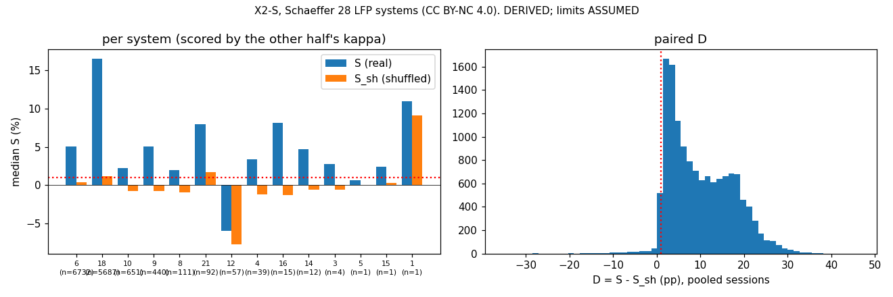

# Results X2-S: X2-F replicated on a second LFP dataset (Schaeffer et al., 28 systems)

Experiment X2-S, run 2026-10-29.

**Read the caveats first** (pre-registration §0):

- All 28 systems were **returned to the manufacturer** for unsatisfactory behaviour, so they are not representative.
- Top-of-charge sessions are dominated by **2 systems** in one half and 3 in the other.
- The packs are 8S, with active balancing.
- The licence is **CC BY-NC 4.0** (non-commercial).

| | |
|---|---|
| **Pre-registration** | [`../X2S_preregistration.md`](../X2S_preregistration.md), commit `dcd07e8`, committed before any limiter code |
| **Code** | `analysis/XS_replay.py` (with `XS_common.py`) |
| **Outputs** | `x2s.json`, `x2s_plots.png` |
| **Tags** | Every number is **DERIVED**. Limits are **ASSUMED** (V_lim 3,650 mV). Q_ref 160 Ah is **SOURCED**. These are replay limiter currents only. |

## Verdict: NOT INTERPRETABLE. The direction repeats strongly.

**The pre-registered verdict is NOT INTERPRETABLE**, in the base case and in every sensitivity variant.

| Fold | Min/max (κ_mm) | Per-cell (κ_c) | Shuffled (κ_s) |
|---|---|---|---|
| **1**: calibrated on A, scored on B | 2.00 (the grid top, **flagged**); held-out unsafe **1.48 %** | 1.11; held-out **0.85 %** | 1.89; held-out 0.28 % |
| **2**: calibrated on B, scored on A | 2.00 (**flagged**; 1.48 % on its calibration half); held-out 0.06 % | 1.60; held-out 0.001 % | 2.00 (**flagged**); held-out 0.004 % |

**The main cause:** min/max cannot be made safe on these packs. Even with its resistance doubled (κ 2.00), a pack-mean R
under-predicts the hottest cell's voltage often enough to exceed the per-cell reference in about 1.5 % of frames.

**If it could be read, the base case would meet every REPLICATED condition except interpretability:**

| Base, both folds (8 qualifying systems, 13,843 primary sessions) | Value |
|---|---|
| **S_sys** (median of system medians) | **+4.2 %** (system bootstrap CI 1.9–6.5 %) |
| S_sh_sys (shuffled) | **−0.75 %** |
| **D_sys** | **+5.2 pp** (CI 3.4–6.5) |
| **Systems with D > 0** | **8 of 8** |
| Systems with S > 0 | 7 of 8. System 12 is −6 % (balancing in 72 % of its charge rows). |
| Pooled over sessions: S / S_sh / D / S_ref | +9.0 % / +0.7 % / +8.5 pp / +11.1 % |
| Binding cell not the max-V cell | 6 % of frames (8S packs) |

**Plain statement.** On a second, independent LFP dataset, the per-cell limiter again admits more current than min/max,
and the shuffled one does not.

- **The same sign appears in every system that qualifies.** That is the mechanism X2-F found on Beihang.
- **The gain cannot be stated as "equally safe" here.** Min/max never reaches the safety target, even at the largest
  margin allowed. In fold 1, the per-cell limiter's margin also fails to transfer.
- **The bias, if any, runs in min/max's favour.** In fold 1, which holds 91 % of primary sessions, min/max is the less
  safe limiter (1.48 % against 0.85 %) and is still slower.

## DEV-1: step direction (found in the smoke test, after `dcd07e8`)

**What was found.** On these systems, R from current steps going **up** differs from R from steps going **down** by
about **2–3×**. Loads switch on and off in pairs, so plain even/odd parity puts mostly one direction in E and the other
in F. The reference then disagrees with the limiters systematically, not just by noise. In the system-14 smoke test,
no κ ≤ 2.00 met 0.01 % for any limiter.

**What DEV-1 does.** The parity split is applied **separately within up-steps and within down-steps**. Everything
else is unchanged. It is reported beside the pre-registered result, **never in place of it**.

| | DEV-1, direction-balanced |
|---|---|
| κ, fold 1 (mm / cell / sh) | 2.00 (flagged) / 1.12 / 1.91 |
| Held-out unsafe, fold 1 (mm / cell / sh) | 1.48 % / **0.27 %** / 0.25 % |
| κ, fold 2 (mm / cell / sh) | 2.00 (flagged) / 1.35 / 2.00 (flagged) |
| S_sys | **+6.2 %** (CI 4.8–7.8) |
| S_sh_sys | −0.8 % |
| D_sys | **+6.0 pp** (CI 5.2–8.6) |
| Systems with D > 0 | **8 of 8** |
| Reading | NOT INTERPRETABLE: min/max is still at the κ cap |

**Readings:**

- DEV-1 brings the per-cell limiter's held-out unsafe fraction down from 0.85 % to 0.27 %. That is close to the bar,
  but still over it.
- It does not help min/max at all.

**X2-F is not affected.** On 12 Beihang QAS evaluation vehicles:

- up-step and down-step R agree within about 3 %;
- even and odd steps are each about 50 % up-steps.

That check was run while X2-S was computing. The asymmetry is a property of this dataset, possibly from the 5 s
sampling or the BMS's measurement timing. That is not verified.

## Sensitivity (pre-registered; all NOT INTERPRETABLE for the same reason)

| Variant | S_sys (CI) | S_sh_sys | D_sys (CI) | D > 0 |
|---|---|---|---|---|
| **Base** | **+4.2 %** (1.9–6.5) | −0.8 % | **+5.2 pp** (3.4–6.5) | 8/8 |
| Window 7 days | +1.8 % (−9.3 to 5.0) | −1.0 % | +2.7 pp (−5.3 to 6.0) | 6/8 |
| Balancing rows allowed in steps | +7.4 % (5.2–9.2) | −0.8 % | +9.3 pp (7.6–10.5) | 8/8 |
| Step 0.2 C | +5.7 % (0.3–11.4) | −0.8 % | +6.8 pp (1.5–11.5) | 8/9 |
| κ tolerance 0.1 % | +3.6 % (3.1–6.3) | −0.8 % | +3.8 pp (0.6–7.0) | 6/8 |
| Depth 25 mV | +4.0 % (−1.2 to 12.2) | 0.0 % | +5.8 pp (2.8–13.9) | 6/6 |
| Depth 100 mV | +3.7 % (1.1–7.0) | −0.8 % | +4.4 pp (2.9–13.5) | 9/9 |
| DEV-1, direction-balanced | +6.2 % (4.8–7.8) | −0.8 % | +6.0 pp (5.2–8.6) | 8/8 |

**Readings:**

- The shuffled limiter sits at about 0 % or below in every variant.
- The real per-cell limiter is ahead in every variant.
- The 7-day window is the weak one. Systems 12 and 21 turn negative with fewer steps per window.

## What this adds to X2-F

| Question | Beihang QAS (X2-F, fine-grid exploration) | Schaeffer (X2-S, pre-registered) |
|---|---|---|
| Does real per-cell R beat shuffled R? | Yes, D about +5–6 pp | **Yes, D +5.2 pp, 8/8 systems** |
| Does per-cell beat min/max? | Yes, about +2.5 % to +4 % | Yes, S_sys **+4.2 %** (pooled +9 %) |
| Is the comparison at equal held-out safety? | Narrowly not (min/max 0.23–0.30 %); yes at 0.01 % tolerance | **No.** Min/max cannot reach the target at κ 2.00. |
| Does the min/max margin transfer to held-out units? | No | No |

**Bottom line.** The per-cell mechanism has now appeared in **two independent LFP datasets**, each pre-registered at
the design level:

- correct cell assignment beats shuffled assignment;
- per-cell limiting beats a pack scalar.

Neither dataset gives a formally interpretable equal-safety comparison. In both, the reason is that **min/max's margin
does not hold on unseen units**. On Schaeffer it cannot be made safe at all within κ 2. That is a finding in its own
right: a pack-scalar limiter needs a much larger, less predictable margin than a per-cell one.

**Board.** None, per §8 of the pre-registration.

## Deviations

- **DEV-1** (above): a direction-balanced E/F variant was added after the pre-registration. It is reported beside the
  pre-registered result and does not change the verdict.
- `XS_common.steps` gained an optional `with_sign` return. Definitions are unchanged.

**Licence:** Schaeffer et al. is CC BY-NC 4.0, so these results are **non-commercial**.
