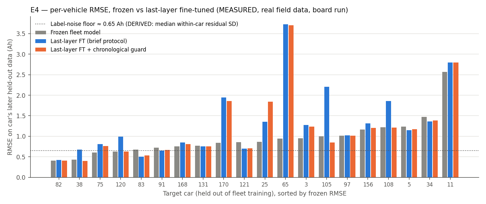
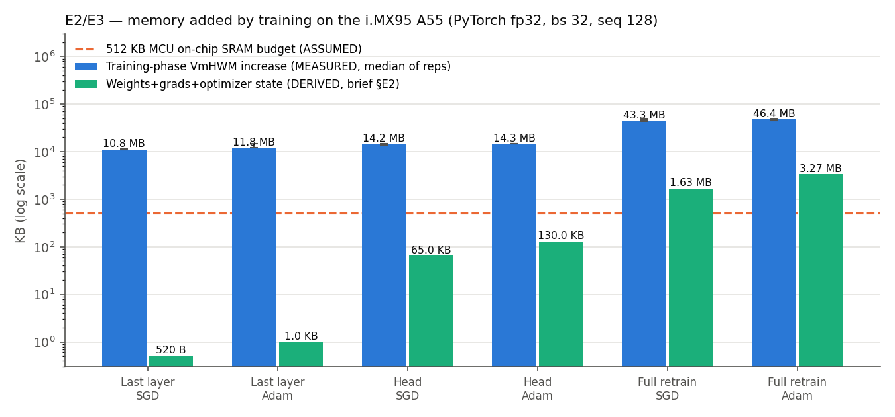

# Results — on-device last-layer fine-tuning of a battery SoH model (FRDM-IMX95-PRO)

Measured 2026-10-08 on **NXP FRDM-IMX95-PRO** (`/proc/device-tree/model`), Yocto, Linux 6.18, 6× Cortex-A55,
16 GB LPDDR. Governor pinned to `performance` (A55 at 1.8 GHz, verified in each JSON), restored to
`ondemand` afterwards. Inference pinned to core 5 (1 thread), training to cores 4–5 (2 threads).
Census before every experiment (per-process CPU delta over 5 s, binaries via `/proc/PID/exe`): **no process
other than the experiment used > 0.5 % of a core** (stock `wireplumber`/`parsec` daemons below that; the
ARA240 proxy daemon is resident by design and idle; NPUs untouched). Exclusive access to the board held throughout.

Tags: **MEASURED** = ran on the board, output gated in the same run · **DERIVED** = arithmetic on stated
inputs · **ASSUMED** = an input we chose to stand in for something not measured · **UNGATED** = no same-run
correctness check, so not quotable. "MB/KB" = MiB/KiB (1024-based). Raw JSON for every number:
`results/raw/`, aggregated in `results/summary.json`.

## Summary table

| Metric | Value | Tag | How measured |
|---|---|---|---|
| Model params | 214,145 (backbone 205,312 · head 8,321 · last layer 65) | MEASURED | `sum(p.numel())` |
| Stored int8 weights | **225,544 B (220 KB)** | MEASURED | `.tflite` size (fp32: 857,692 B) |
| Inference activation arena | ≤ 34.7 KB (incl. 768 B LSTM state) | DERIVED | sum of non-constant tensor bytes, `model/arena_bound.py`; real arena ≤ this |
| Inference RSS added by interpreter + model | **3.4 MB** (int8) · 3.8 MB (fp32) | MEASURED (gated) | VmRSS after `allocate_tensors` − before; Python process |
| Peak inference RSS, whole process | 43.7 MB (int8) | MEASURED (gated) | VmHWM; ~36 MB is Python + numpy + tflite_runtime before the model loads |
| Inference latency, int8 | **22.84 ms p50 · 22.95 ms p99** | MEASURED (gated) | 1,000 invokes, 1 thread, core 5; board output **bit-identical** to host on 256 held-out snippets |
| Inference latency, fp32 | 37.45 ms p50 · 37.91 ms p99 | MEASURED (gated) | as above; matches PyTorch to 7.6e-6 Ah |
| Full-retrain peak RSS, SGD | 405.8 MB (403.0–408.2) | MEASURED | VmHWM, 3 reps; **of which 43.3 MB (42.8–46.6) added by training** |
| Full-retrain peak RSS, Adam | 408.8 MB (405.8–409.2) | MEASURED | VmHWM, 3 reps; **46.4 MB (43.9–46.9) added by training** |
| Last-layer FT peak RSS, SGD / Adam | 372.5 / 373.6 MB | MEASURED | VmHWM, 3 reps; **10.8 / 11.8 MB added by training** |
| Last-layer optimizer state, Adam | **520 B** (65 params) | MEASURED | bytes of live optimizer state tensors |
| Full-retrain optimizer state, Adam | 1,713,160 B (1.63 MB) | MEASURED | as above; = exactly 8 B/param (m + v) |
| Weights + grads + opt. state, full (SGD / Adam) | 1.63 MB / 3.27 MB | DERIVED | 214,145 × 8 / 16 B (brief §E2) |
| Weights + grads + opt. state, last layer (SGD / Adam) | 520 B / 1,040 B | DERIVED | 65 × 8 / 16 B |
| Training step time (bs 32, seq 128, 2 threads) | full 1.19 s · last layer 0.44 s | MEASURED | wall clock / 60 steps |
| Frozen RMSE (20 held-out cars) | **median 0.860 Ah** (IQR 0.708–1.053) | MEASURED | later 50 % of each car's history; real field data |
| Last-layer fine-tuned RMSE | **median 1.085 Ah** (IQR 0.740–1.487) | MEASURED | FT on the car's first 30 %, 300 Adam steps |
| RMSE reduction, last-layer FT vs frozen | **median −12.6 %** (IQR −56.8 % … +3.6 %); improved 6 / 20 cars | DERIVED | from the two rows above |
| Label-noise floor | ≈ 0.65 Ah | DERIVED | median within-car SD of labels about a per-car linear fit vs odometer |
| History buffer, raw (full retrain) | 49 KB (1 h @ 1 Hz) … 38.5 MB (8 h @ 100 Hz) | DERIVED | 7 ch × 2 B × rate × window (E5 table) |
| History buffer, last-layer FT (median car, 915 examples) | 232 KB cached features vs 1.6 MB raw | DERIVED | 260 B vs 1,792 B per example |

## Hypotheses — what the data says

| # | Hypothesis | Verdict |
|---|---|---|
| H1 | SoH NN is tiny: sub-MB int8 weights, tens of KB inference RAM | **Weights: supported** (220 KB, MEASURED). **Inference RAM: supported only as DERIVED** (≤ 34.7 KB arena); the smallest *measured* figure is 3.4 MB, because a Python process adds runtime allocations we cannot separate from the arena. A C harness would be needed to measure the arena itself. |
| H2 | Full-retrain state is several × inference, and the multiplier depends on optimizer (SGD ≈ 8 B/param, Adam ≈ 16 B/param) | **Accounting supported, measured peak not.** The optimizer state is exactly as predicted (Adam adds 1.63 MB, MEASURED). But training *adds* 43–46 MB, and the SGD-vs-Adam difference (≈ 3 MB) is about the size of the rep-to-rep spread. **Peak training memory is dominated by backprop-through-time activations (128 steps × batch 32), not by optimizer state** — the brief's B/param model under-predicts the measured increment by ~14× (Adam) to ~27× (SGD). Full retrain at either end: tens of MB, far beyond a 512 KB SRAM budget (ASSUMED). |
| H3 | Last-layer FT fits a sub-MB optimizer-state budget, roughly flat across SGD/Adam | **Supported for optimizer state** (520 B Adam, 0 B SGD — MEASURED; flat). The *training-phase increment* in PyTorch is still 10.8–11.8 MB — see "fixed-cost probe" below for what that is. With cached embeddings (as E4 does), each step is a 64→1 linear update. |
| H4 | Fine-tuning on a vehicle's own data beats the fleet-average model on its held-out data | **Not supported.** Real field data, 20 held-out cars, on the board: last-layer FT **worsened** median RMSE by 12.6 % and helped only 6 / 20 cars. See below. |
| H5 | Full-retrain history buffer large; last-layer window small | **Partly.** Raw history is large at realistic rates (DERIVED table). Last-layer FT needs the *same number* of examples in our protocol, but each can be stored as a 260 B cached feature instead of a 1,792 B raw window (≈ 7× smaller). It does not need a shorter history. |

## E4 in detail — why fine-tuning did not help

Per car, the labelled history is sorted by odometer: **first 30 % → fine-tune**, next 20 % gap, **last 50 % → test**.
All rows below are MEASURED on the board (same 20 cars; none was in fleet training).

| Condition | Median RMSE (Ah) | IQR | Beats frozen on |
|---|---|---|---|
| **Frozen fleet model** | **0.860** | 0.708–1.053 | — |
| Last-layer FT (65 params) — brief protocol | 1.085 | 0.740–1.487 | 6 / 20 |
| Last-layer FT + chronological guard | 0.932 | 0.699–1.273 | 10 / 20 |
| Whole-head FT (8,321 params) | 0.978 | 0.655–1.256 | — |
| Whole-head FT + guard | 0.815 | 0.620–1.215 | — |
| Bias-only (1 param, closed form) | 0.980 | 0.688–1.088 | — |
| Predict mean of car's own early labels | 2.223 | 1.912–3.206 | — |

Three findings, each checked rather than assumed:

1. **The frozen model is already near the label-noise floor.** Median 0.86 Ah vs ≈ 0.65 Ah noise (DERIVED).
   There is at most ~0.2 Ah to recover. The fleet model gets the vehicle's age from the odometer input.
2. **Early data cannot teach later degradation.** Each car's test window starts 2.5–45 k km (median 21 k km)
   after its FT window ends and runs to a median 77 k km (max 154 k km) beyond it; the mean capacity label
   falls by a median 2.0 Ah (range −0.1 … 4.3 Ah) from FT window to test window. Unconstrained FT fits the
   early regime and loses the fleet's degradation slope (worst: car 65, FT on 96–112 k km, tested on
   129–204 k km: 0.94 → 3.73 Ah).
3. **This is not caused by a strong fleet model leaving no headroom.** Sensitivity (host): with the odometer
   channel held at 0, the fleet model is weaker (frozen median 1.25 Ah) — and last-layer FT hurts *more*
   (median −44 %, 6 / 20 improved). The protocol, not the model, is what fails.

Sensitivity points (all named, none tuned on test data): the **chronological guard** picks the FT step count
(0 allowed = keep frozen) on the most recent 25 % of the car's own FT window — it never sees the test set.
It cuts the median excess over frozen from 0.225 Ah to 0.072 Ah but does not make last-layer FT better than frozen at the median. **FT fraction 10 %** (board, MEASURED): last-layer FT median RMSE 1.211 Ah (IQR 0.727–1.833) vs frozen
0.860; median per-car change −1.8 % but IQR −89 % … +6 %, improved 9 / 20; guarded 0.895 Ah; whole-head
guarded 0.860 Ah. Less own-data makes the outcome noisier, not better.

**Host vs board:** frozen, bias and early-mean RMSE are identical to the host run; the trained variants agree
to ~0.02 Ah (ARM vs x86 float accumulation in the training loop). The conclusion is the same on both.

## E2/E3 in detail — memory

Absolute peak RSS is ~370–410 MB for every training mode because importing torch alone is 225 MB and the
fine-tune car's data + model + features bring the floor to ~347 MB. **The plot therefore shows the memory the
training phase adds** (VmHWM after the loop − VmHWM before it, in a fresh process per config), next to the
DERIVED weights+grads+optimizer bytes. Each config: 3 reps, all gates passed (finite losses; full fine-tune-set
loss lower after training; frozen parameters **bit-identical** after training; trainable ones changed).

> **Erratum / reference-point note (added 2026-10-08, from Analysis Brief Exp D — see `results_large.md` §D).**
> The "added by training" figures above are VmHWM after training − VmHWM before it, and the "before" mark came
> from a no-grad pass over the fine-tune set in batches of 32 — so they **exclude** the ~14 MB batch-32 forward
> working set (it was already in the baseline). Measured against *RSS before training* instead, last-layer FT
> adds **≈ 25–27 MB** and full retrain **≈ 60 MB** here (same JSONs: `hwm_peak − rss_baseline`). Optimizer state
> and step times are unaffected. Every conclusion above stands: tens of MB on an A55 + DDR part is easy, and far
> beyond a 512 KB MCU budget — but quote the reference point with the number.

**Fixed-cost probe** (`board/probe_fixed_cost.sh`; same configs, **1 training step instead of 60**, 2 reps).
The 1-step runs are **UNGATED** for quotation (a single SGD step does not reliably lower the loss — the full
retrain gate failed, as expected) and are used **only** to decompose the memory figures above:

| Config | Increment after 1 step | Increment after 60 steps (E2/E3) |
|---|---|---|
| Last layer, SGD | 8.1 / 9.3 MB | 10.8 MB (10.7–11.0) |
| Full retrain, SGD | 41.7 / 42.9 MB | 43.3 MB (42.8–46.6) |

So the increment is reached on the **first** step and does not accumulate. For full retrain, ~43 MB is the
working set of one backprop-through-time step (activations for 128 steps × batch 32 × 2 LSTM layers) —
genuine per-step workload memory. For the last layer, the ~8–9 MB is essentially PyTorch's one-time cost of the
first backward/optimizer pass (autograd engine and allocator warm-up), not memory that scales with what is
trained (65 params, 520 B of optimizer state). A purpose-built on-device fine-tuner (cached 64-d features,
one 64→1 update) would not carry it; this study did not build or measure one.

## E5 — history-buffer sizing (all DERIVED)

Raw history = 7 channels × 2 B (int16, ASSUMED) × sample rate × window. The EVBattery data itself is sampled
at 0.1 Hz (one frame / 10 s); the 1/10/100 Hz columns are the brief's requested what-ifs.

| Window | 1 Hz | 10 Hz | 100 Hz |
|---|---|---|---|
| 10 min | 8.2 KB | 82.0 KB | 820.3 KB |
| 1 h | 49.2 KB | 492.2 KB | 4.8 MB |
| 8 h (drive day) | 393.8 KB | 3.8 MB | 38.5 MB |
| 7 days | 8.1 MB | 80.7 MB | 807.5 MB |

What a last-layer fine-tune actually needs, using E4's own FT sets (median car: 915 labelled charge snippets,
largest: 2,221): kept **raw** (128 × 7 × 2 B = 1,792 B each) that is **1.6 MB** (median) / 3.8 MB (max); kept as
**cached 64-d fp32 features + label** (260 B each — possible only because the backbone is frozen) it is
**232 KB** / 564 KB. Full retrain cannot use the cached form: the backbone must see raw windows again.

## Inputs — chosen vs imposed (brief §0.5)

| Input | Value | Chosen / imposed |
|---|---|---|
| Dataset | EVBattery sub-dataset 1 (one manufacturer, 100 labelled cars) | chosen — see README for why not the Changan 300-EV set |
| Snippet length / cadence | 128 samples @ 10 s | imposed by dataset |
| Features | 7 raw channels + rolling mean/std (8 samples) of V, I, Tmax + odometer; z-score clipped ±6 | chosen |
| Architecture | 2 × LSTM-128 → Linear 64 → ReLU → Linear 1 | chosen |
| Fleet training | Adam 1e-3, bs 256, 68 train cars, early stop on 12 val cars (val RMSE 1.196 Ah vs mileage-only linear 1.290, fleet mean 1.904) | chosen |
| Quantization | full int8 (int8 I/O), 500-snippet calibration set from train cars | chosen |
| E2/E3 training | fp32, bs 32, 60 steps, SGD lr 1e-2 (no momentum) / Adam lr 1e-3, one target car (car 3, 1,118 FT snippets) | chosen |
| E4 split | 30 % FT / 20 % gap / 50 % test, chronological per car | chosen (brief: "early" vs "later") |
| E4 fine-tune | Adam 1e-3, bs 32, 300 steps | chosen |
| SRAM reference | 512 KB | ASSUMED |
| Raw sample width | 2 B (int16) | ASSUMED |

## Honest verdict

On this board, a 214k-parameter LSTM SoH model is small: **220 KB of int8 weights and 22.8 ms per inference on
one A55 core (MEASURED, output-gated)**, with an activation arena DERIVED at ≤ 34.7 KB. **Last-layer
fine-tuning is cheap on an A55 + DDR part** — 520 B of Adam state and a sub-second step — while **full
retraining adds tens of MB, far beyond a 512 KB MCU SRAM budget (ASSUMED)**, mostly from backprop-through-time
activations rather than optimizer state; the SGD/Adam difference the brief predicted is real in the byte
accounting but sits inside the measurement spread. **But H4 — the hypothesis that turns "feasible" into
"worth doing" — was not supported:** on real EV field data, fine-tuning the last layer on a car's early
history made its later predictions worse in 14 of 20 cars, because the dominant per-vehicle change over time
is degradation that early data cannot show. Nothing here used synthetic drift. The figures are specific to
this i.MX 95 board and to this model, data and protocol, and should not be generalized beyond them. A fair
next test is a rolling scheme (re-fine-tune periodically on recent data, predict the near future), which
this study did not run.
