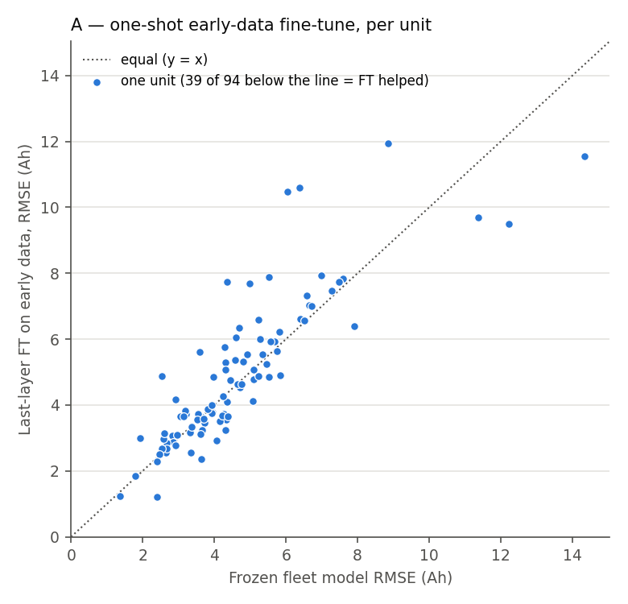
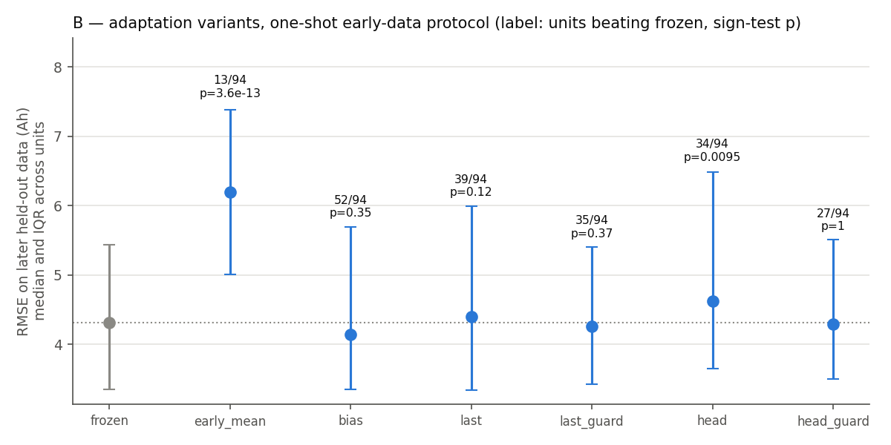
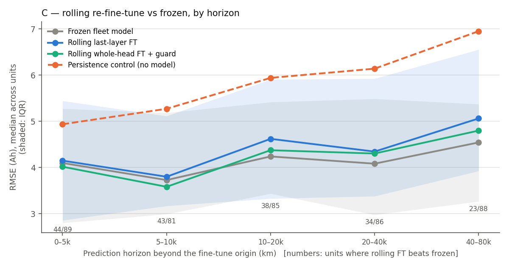

# Results (large) — does per-unit fine-tuning beat the fleet model at scale?

Analysis Brief §1, run 2026-10-08. Prerequisite: [`results.md`](results.md) (n = 20, EVBattery, one manufacturer —
one-shot early-data fine-tuning **hurt** 14 / 20). Profile of the new data first:
[`dataset_profile.md`](dataset_profile.md). **Read the profile before any number here** — on the large set, the
capacity labels are something *we derived*, not something the dataset provides.

**Data.** Changan 300-EV field fleet (Liu et al., *Nat. Commun.* 2025; CC BY-NC-SA 4.0, academic use): all
300 vehicles, one OEM, NMC, 10 s telemetry, 130–220 k km typical span. Labels = **charge capacity to the 4.2 V
cutoff at a ≈ 49.5 A end current**, by Ah-integration from a post-rest SOC (our own OCV table — ASSUMED, the
OEM's is unpublished) — so **every RMSE on this set is a MEASURED error against a DERIVED label**. Two label
sets: *primary* (94 qualifying units) and *strict* (45 units, cleaner labels). Second dataset for the rolling
test: EVBattery sub-dataset 1 (the prior run's 20 held-out cars; labels supplied by the dataset).

**Protocol.** Fleet models trained per fold (4-fold by unit: each qualifying unit is held out exactly once,
never in its own fleet's training or early-stopping set). Every fold's fleet model beats both a fleet-mean and a
mileage-linear baseline on its validation units (LSTM 4.36–4.59 Ah vs mileage-linear 5.45–5.87 Ah, primary;
3.96–4.62 vs 4.94–5.88, strict). All gates passed in every run (frozen parameters bit-identical after every
fine-tune, trainable ones changed, losses finite). **Robustness rule:** a method "helps" only if it beats frozen
at the median, on a majority of units, *and* a two-sided sign test rejects at the **Bonferroni level
0.05 / 20 = 0.0025** (5 horizons × 4 fine-tune methods per label set) — *and* it does the same against the
no-model persistence control. Raw p-values are reported throughout.

## Summary table

| Metric | Value | Tag | How |
|---|---|---|---|
| Units evaluated (primary / strict) | **94 / 45** | MEASURED | qualifying = ≥ 20 labels over ≥ 50 k km |
| Label-noise floor, primary / strict (median within-unit SD; MAD) | 4.76; 3.91 / 3.84; 2.76 Ah | DERIVED | SD of a unit's labels about its own linear fit vs odometer |
| Frozen fleet RMSE, one-shot test window (median, primary / strict) | 4.31 / 3.28 Ah | MEASURED vs DERIVED labels | later 50 % of each unit's history |
| **A: last-layer FT on early data vs frozen** (primary) | **median +1.9 %; better on 39 / 94; p = 0.12** | MEASURED vs DERIVED labels | 30 % FT / 20 % gap / 50 % test |
| A: same, strict | **+10.4 %; better on 15 / 45; p = 0.036 (worse)** | MEASURED vs DERIVED labels | |
| B: best one-shot variant (bias-only, primary) | −1.0 %; better on 52 / 94; p = 0.35 | MEASURED vs DERIVED labels | not significant |
| B: whole-head FT (primary / strict) | +4.9 % (34 / 94, p = 0.0095) / +17.5 % (10 / 45, p = 0.00025) — **significantly worse** | MEASURED vs DERIVED labels | |
| **C: rolling last-layer FT vs frozen, 0–5 k km** (primary) | 4.15 vs 4.10 Ah; better on 44 / 89; p = 1 | MEASURED vs DERIVED labels | re-FT every 10 k km on the last 30 k km |
| C: same, 40–80 k km (primary) | 5.06 vs 4.54 Ah; better on 23 / 88; **p = 8.5e-6 (worse)** | MEASURED vs DERIVED labels | |
| C: methods that "help" robustly, any horizon, either label set | **none** | DERIVED (test) | Bonferroni 0.0025 vs frozen *and* vs persistence |
| C on EVBattery, 0–5 k km: rolling last-layer vs frozen | 0.73 vs 0.84 Ah; better on 17 / 19; p = 0.0007 | MEASURED (supplied labels) | |
| C on EVBattery, 0–5 k km: rolling last-layer vs **no-model persistence** | 0.73 vs 0.73 Ah; better on 6 / 19; p = 0.17 | MEASURED (supplied labels) | mean of the unit's last 5 k km of labels |
| D: optimizer state on the board, large-data model (last / head / full, Adam) | **520 B / 66,568 B / 1,713,160 B — identical to `results.md`** | MEASURED | live optimizer tensors, 2 reps, all gates passed |
| D: peak − pre-training RSS, last-layer / full (Adam) | 29.7 / 59.0 MB (prior run: 27.2 / 60.4 MB) | MEASURED | VmHWM after − VmRSS before training |

## A — reproduce the prior negative at scale: **it reproduces**

One-shot fine-tuning on each unit's earliest 30 % of history, scored on its latest 50 %:

| Condition | Primary (n = 94): median RMSE · better than frozen · p | Strict (n = 45) |
|---|---|---|
| **Frozen fleet model** | **4.31 Ah** (IQR 3.35–5.43) | **3.28 Ah** (IQR 2.73–4.26) |
| Last-layer FT (65 params) | 4.39 · 39 / 94 · p = 0.12 | 3.79 · 15 / 45 · p = 0.036 |
| Last-layer FT + guard | 4.25 · 35 better / 32 tied / 27 worse · p = 0.37 | 3.40 · 14 / 11 / 20 · p = 0.39 |
| Whole-head FT (8,321 params) | 4.62 · 34 / 94 · p = 0.0095 (worse) | 4.22 · 10 / 45 · p = 0.00025 (worse) |
| Whole-head FT + guard | 4.29 · 27 / 39 / 28 · p = 1 | 3.64 · 15 / 15 / 15 · p = 1 |
| Bias-only (closed form) | 4.14 · 52 / 94 · p = 0.35 | 3.34 · 23 / 45 · p = 1 |
| Predict unit's own early-label mean | 6.20 · 13 / 94 · p = 3.6e-13 (worse) | 4.90 · 5 / 45 · p = 7.9e-8 (worse) |

("Tied" = the guard chose 0 fine-tune steps, i.e. kept the frozen model.)

## B — which variant helps? **None, at the median and robustly**

In this one-shot protocol the guard works as designed — it stops the damage (guarded variants are never
significantly worse here; in the rolling protocol below, guarded whole-head *is* worse at 20–80 k km, p ≈ 0.01)
— but it does so mostly by *declining to fine-tune*: it kept the frozen model for 32–39 of 94 units. Unguarded,
whole-head fine-tuning is the worst variant on both label sets. The prior run's hint that guarded whole-head
fine-tuning "got marginally below frozen" does **not** survive scale: 4.29 vs 4.31 Ah, 27 better / 28 worse.

## C — the rolling protocol (the fair test): **no robust benefit on Changan; on EVBattery the near-term gain is persistence, not fine-tuning**

Re-fine-tune from the fleet weights every 10 k km on the unit's most recent 30 k km, predict labels in each
horizon band. Same (origin, label) pairs for every method. Cells: median RMSE (Ah) · units better than frozen ·
sign-test p.

**Changan, primary labels**

| Horizon | n | Frozen | Bias | Last-layer | Last + guard | Head + guard | Persistence (no model) |
|---|---|---|---|---|---|---|---|
| 0–5 k km | 89 | **4.10** | 3.91 · 55 · p=0.033 | 4.15 · 44 · p=1 | 4.02 · 52 · p=0.086 | 4.02 · 46 · p=0.38 | 4.94 · 25 · p=4.3e-05 |
| 5–10 k km | 81 | **3.73** | 3.70 · 48 · p=0.12 | 3.80 · 43 · p=0.66 | 3.61 · 42 · p=0.42 | 3.58 · 42 · p=0.36 | 5.27 · 20 · p=5.7e-06 |
| 10–20 k km | 85 | **4.24** | 4.22 · 42 · p=1 | 4.62 · 38 · p=0.39 | 4.21 · 48 · p=0.23 | 4.37 · 43 · p=0.74 | 5.94 · 17 · p=2.2e-08 |
| 20–40 k km | 86 | **4.08** | 4.18 · 37 · p=0.24 | 4.34 · 34 · p=0.066 | 4.12 · 35 · p=0.19 | 4.30 · 30 · p=0.015 | 6.14 · 12 · p=4.7e-12 |
| 40–80 k km | 88 | **4.54** | 4.56 · 39 · p=0.34 | 5.06 · 23 · p=8.5e-06 | 4.80 · 35 · p=0.086 | 4.80 · 30 · p=0.012 | 6.95 · 8 · p=4.6e-16 |

**Changan, strict labels**

| Horizon | n | Frozen | Bias | Last-layer | Last + guard | Head + guard | Persistence (no model) |
|---|---|---|---|---|---|---|---|
| 0–5 k km | 37 | **3.27** | 2.92 · 20 · p=0.74 | 2.97 · 17 · p=0.74 | 3.01 · 26 · p=0.011 | 3.19 · 23 · p=0.13 | 3.92 · 13 · p=0.099 |
| 5–10 k km | 35 | **3.05** | 2.98 · 14 · p=0.31 | 3.22 · 15 · p=0.5 | 3.10 · 15 · p=0.73 | 3.01 · 15 · p=0.86 | 3.93 · 8 · p=0.0019 |
| 10–20 k km | 39 | **3.17** | 3.00 · 17 · p=0.52 | 3.25 · 17 · p=0.52 | 2.98 · 23 · p=0.13 | 3.08 · 20 · p=0.5 | 4.54 · 4 · p=3.4e-07 |
| 20–40 k km | 37 | **3.23** | 3.24 · 16 · p=0.51 | 3.51 · 16 · p=0.51 | 3.18 · 25 · p=0.047 | 3.10 · 21 · p=0.51 | 5.03 · 6 · p=4.1e-05 |
| 40–80 k km | 38 | **3.42** | 3.54 · 18 · p=0.87 | 3.86 · 14 · p=0.14 | 3.40 · 14 · p=0.19 | 3.64 · 16 · p=0.62 | 5.97 · 4 · p=6e-07 |

The most favourable cell in the whole analysis is **strict, guarded last-layer, 0–5 k km: 26 / 37 better,
p = 0.011**. With 20 tests per label set, p ≈ 0.01 somewhere is what chance produces; it does not clear the
pre-declared 0.0025, and the same method is not better at any other horizon. It is reported, not claimed.

The **crossover** the brief anticipated exists only as harm: rolling last-layer FT is roughly neutral out to
~10 k km and then gets worse than frozen, significantly at 40–80 k km (23 / 88, p = 8.5e-6). On Changan the
no-model persistence control is far worse than frozen at every horizon — the fleet model already extracts more
from a unit's recent charging than "recent labels" do.

**EVBattery (second dataset, supplied labels, 19–20 units, prior run's held-out cars; `large/rolling_evb_ds1.json`):**

| Horizon | Frozen | Rolling last-layer (better · p) | Persistence (no model) | Last-layer vs persistence (better · p) |
|---|---|---|---|---|
| 0–5 k km | 0.84 | **0.73 · 17 / 19 · p = 0.0007** | **0.73** (16 / 19 better than frozen, p = 0.0044) | 6 / 19 · p = 0.17 |
| 5–10 k km | 0.80 | 0.77 · 10 / 19 · p = 1 | 0.80 | 14 / 19 · p = 0.064 |
| 10–20 k km | 0.78 | 0.89 · 11 / 19 · p = 0.65 | 1.08 | 13 / 19 · p = 0.17 |
| 20–40 k km | 0.89 | 1.15 · 7 / 19 · p = 0.36 | 1.44 | 16 / 19 · p = 0.0044 |
| 40–80 k km | 0.92 | 1.55 · 2 / 18 · p = 0.0013 (worse) | 2.48 | 15 / 18 · p = 0.0075 |

This is the only place per-unit information beats the fleet model **robustly** — at 0–5 k km on EVBattery — and
it is **fully matched by the persistence control**: the mean of the unit's own last 5 k km of capacity labels,
no model, no training. Fine-tuning adds nothing over storing recent measurements. (Persistence was added
*after* the first preliminary results — disclosed in `analysis/rolling.py` — and it can only make a positive
claim harder.)

## D — feasibility on the board with the large-data model: **confirmed, with one correction to how `results.md` reported it**

Same board, same harness (`board/run_expD.sh`: governor pinned to `performance` and restored, cores 4–5, census
before — nothing else above 0.5 % of a core — `timeout -k`, exclusive board access, end-of-run census diffed against the start), with the
Changan fold-0 fleet model and one Changan target unit (11 fine-tune examples). 2 reps per config; every gate
passed.

| Config | Optimizer state (MEASURED) | Step time | Peak − RSS before training | Peak − *VmHWM* before training |
|---|---|---|---|---|
| Last layer, SGD / Adam | 0 / 520 B | 445 / 442 ms | 27.2 / 29.7 MB | 27.2 / 29.7 MB |
| Head, Adam | 66,568 B | 445 ms | 31.4 MB | 31.4 MB |
| Full, Adam | 1,713,160 B | 1,192 ms | 59.0 MB | 59.0 MB |
| *Prior run (results.md), last-layer SGD / Adam* | *0 / 520 B* | *442 / 445 ms* | *24.9 / 27.2 MB* | *10.8 / 11.8 MB* |
| *Prior run, full Adam* | *1,713,160 B* | *1,192 ms* | *60.4 MB* | *46.4 MB* |

**What holds:** optimizer state and step time are byte- and millisecond-identical — they depend on parameter
count and batch × sequence length, not on how much data the fleet model was trained on. Feasibility stands.

**What this exposed (RoE #6 — the reference point is a choice):** `results.md` reported training memory as
VmHWM after training minus VmHWM *before* training, where the "before" high-water mark came from a no-grad pass
over the unit's fine-tune set in batches of 32. With 1,118 fine-tune examples that pass reached batch 32 and
already held the ~14 MB forward working set; with 11 examples (Changan) it never did, so the same working set
moved into the "training" increment (10.8 → 27.2 MB). Measured against **RSS before training** — a reference
that does not depend on the fine-tune set size — the two runs agree (≈ 25–30 MB last-layer, ≈ 59–60 MB full).
Both numbers are MEASURED; they answer different questions. `results.md` is annotated accordingly.

## Inputs — chosen vs imposed

| Input | Value | Chosen / imposed |
|---|---|---|
| Label definition | Ah from post-rest OCV SOC to max-cell ≥ 4.20 V, fast-charge end current 48–51 A, 95–145 Ah | chosen (forced by: no released label, no OEM OCV table, BMS SOC stale at full) |
| OCV table | from each unit's first 20 k km of rests | ASSUMED |
| Target eligibility | ≥ 20 labels over ≥ 50 k km | chosen |
| Folds | 4, by unit | chosen |
| Model / features / fleet training | as in `results.md` (2 × LSTM-128, 214,145 params, odometer input) | chosen (carried over unchanged) |
| One-shot split | 30 % FT / 20 % gap / 50 % test | chosen (same as prior run) |
| Rolling | origin every 10 k km; FT window 30 k km; bands 0–5 / 5–10 / 10–20 / 20–40 / 40–80 k km | chosen, declared before results |
| Fine-tune | Adam 1e-3, bs 32, 300 steps; guard = most recent 25 % of the FT window, steps ∈ {0, 25, 50, 100, 200, 300} | chosen (same as prior run) |
| Robustness | sign test, Bonferroni over 20 tests per label set | chosen (Bonferroni added after a preliminary p = 0.022 — disclosed) |

## Decision (brief §4.4)

**PER-UNIT ADAPTATION DOES NOT HELP** — on this fleet, at this label quality.

- The prior negative **reproduces at scale** (94 units vs 20): one-shot early-data fine-tuning never helps and
  whole-head fine-tuning significantly hurts, on both label sets.
- The **fair rolling protocol** finds no variant that robustly beats the frozen fleet model at any horizon on
  either label set, and last-layer fine-tuning significantly hurts at long horizons.
- The **one robust near-term gain** (EVBattery, 0–5 k km) is matched exactly by a no-model persistence control.
  The honest reading: a unit's *own recent capacity measurements* can carry near-term information the fleet model
  lacks — and capturing it needs a running average, not on-device training.
- The fleet model sits **at the label-noise floor** (rolling frozen medians 3.73–4.54 Ah vs ≈ 3.9–4.8 Ah noise,
  primary; 3.05–3.42 vs ≈ 2.8–3.8, strict). That is the ceiling, as the brief anticipated.

**Scope, stated once and meant:** one OEM's NMC fleet with **derived** labels whose per-unit noise is ~45–75 % of
the unit's whole-life fade (depending on label set and noise measure), plus a 20-unit second dataset. This does not show that per-unit adaptation can
never help — a dataset with lab-grade per-unit capacity measurements (noise ≪ fade) over long field histories
could still find a regime where it does; neither dataset here can see one if it exists below ~3 Ah. What it
does show is that, on the best public field data we could get, the "per-vehicle data beats fleet-average"
claim is not supported for *fine-tuning*.

## Honest verdict

On the Changan 300-EV fleet (all 300 vehicles; 94 qualifying units on the primary labels, 45 on the strict
ones), with capacity labels we had to derive ourselves (Ah-integration to a 4.2 V cutoff from an OCV table we
built — ASSUMED — because the OEM's is unpublished), fine-tuning a battery-SoH model on a vehicle's own data
does not beat the fleet-average model: not one-shot on early data (reproducing the earlier n = 20 negative at
4.7× the units), and not with a rolling re-fine-tune at any horizon from 5 to 80 k km, under a pre-declared
Bonferroni-corrected sign test. Chosen inputs that matter: the label definition (fast-charge only — slow-charge
labels showed no ageing trend), the 30 k km rolling window, the 300-step Adam fine-tune and its guard. Caveats:
every Changan RMSE is measured against a DERIVED label; N = 94 is six short of the brief's 100; the
persistence control and the Bonferroni rule were added after preliminary results (both can only make a
positive finding harder). No synthetic drift was used anywhere. The feasibility and bandwidth arguments in
`results.md` stand on their own measured numbers; the accuracy claim — "per-vehicle data, used by on-device
fine-tuning, beats fleet-average" — should be dropped.

## Post-review addendum (2026-10-15, independent review)

See [`review_2026-10-15/REVIEW.md`](review_2026-10-15/REVIEW.md). The text above is unchanged.

1. **"Per-unit adaptation does not help" is too broad. It holds for on-device *training*.**
   - The rolling protocol tested a closed-form *shrunken* per-unit residual offset: κ = 3.55, from E's variance
     split, with a 10 k km EWMA.
   - At 0–5 k km on primary labels it **passes every clause of the pre-declared "helps robustly" rule** (✔
     reproduced by the main session; `review_2026-10-15/scripts/s12/d2_shrink_eb.py`):
     - median 3.85 vs 4.10 Ah;
     - beats frozen on 67 of 89 units, p = 1.9e-6;
     - beats persistence on 70 of 89 units, p = 5e-8.
   - **Caveats:**
     - the method family is post hoc;
     - κ uses a whole-data variance split;
     - it passes in one band only;
     - on strict labels it points the same way but does not pass (24 of 37 units, sign p = 0.10).
   - It needs a pre-registered confirmation.
2. **"Persistence matches the only gain" is EVBattery-specific.** On Changan, recent-label persistence is the weakest
   control.
3. **The "label-noise floor" is an upper bound, not a ceiling.** Frozen RMSE is below the unit's own floor in 54 of
   94 units. Out-of-unit covariate correction lowers the floor from 4.76 to 4.49 Ah (reviewer).
4. **Label defects.**
   - Labels rise +2.34 Ah per e-fold of wake→full segment duration; 6–24 h segments (7.4 % of primary labels) are
     about +3.7 Ah high. This is fixable at `data/changan_labels.py:36`.
   - `odo.min()` NaN-poisoning drops 8 of 300 vehicles from the OCV table. Negligible.
5. **Statistics.**
   - The Bonferroni family is per label set.
   - "Significantly worse at 40–80 k km" holds unguarded only.
   - Whole-head harm (p = 0.0095) is not significant at the 0.0025 rule.
